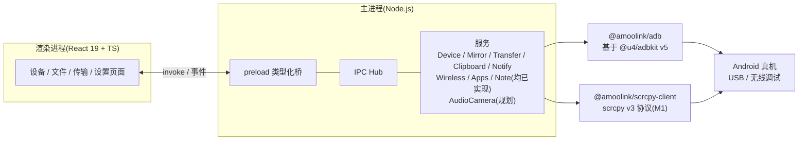

# AmooLink

> 跨平台手机互联应用:任意 Android 手机开启 USB / 无线调试即可即插即用。对标华为多屏协同 / 小米妙享 / Samsung Flow,但不绑定手机厂商。

**技术栈**:Electron 45 + Node.js + React 19 + TypeScript + electron-vite 6 · pnpm monorepo · 桌面端 macOS + Windows

## 功能特性

| 功能 | 里程碑 | 状态 |
|---|:---:|---|
| 设备实时监听 + 档案采集(型号 / 系统 / 屏幕 / 电量 / 存储,真机已验证) | M0 | ✅ 已实现 |
| 投屏反控(scrcpy v3.3.1 协议 + WebCodecs 解码、鼠标键盘滚轮反控、锁屏/亮屏、多设备、自动重连、旋转自适应、截图到剪贴板) | M1 | ✅ 已实现(USB + 无线) |
| 文件互传(浏览器、拖拽到投屏窗口/文件页目录即传、拖出窗口即下载、批量下载、队列进度、APK 拖入即装、相册导出) | M2+ | ✅ 已实现 |
| 剪贴板双向同步(手动/自动)、手机截图→电脑剪贴板、电脑剪贴板图片→手机相册、通知同步(系统通知+通知页) | M3 | ✅ 已实现 |
| 无线连接(一键 tcpip / Android 11+ 配对码 / mDNS 自动发现,adb 二进制随包分发) | M2/M4 | ✅ 已实现 |
| 音频转发、录屏(mp4)、H.265、应用面板、托盘/开机自启、笔记模块(桌面端;手机端笔记 App 已独立为 [ANotes](https://github.com/TrancyH/ANotes) 仓库,平级目录 `../ANotes`,同步协议不变) | M4/M6 | ✅ 已实现 |
| 虚拟摄像头(手机摄像头作为电脑虚拟摄像头) | M4 | ⬜ 计划中(docs/07) |
| 伴侣 APK(Kotlin:mTLS+OTP+SAS 配对、通知实时同步与快捷回复、短信/通讯录+vCard 导出、来电提醒+投屏静音、剪贴板互发与加密历史、免 USB 调试常驻) | M5 | ✅ 已实现(真机探针通过;剪贴板手机→电脑方向受 Android 焦点模型限制为降级可用) |

## 架构一览



- **设备通道唯一化**:全应用只有主进程持有 adb 连接(及未来的 scrcpy socket),渲染进程一律经 IPC 获取数据。
- M1 起:投屏视频/音频字节经 `MessagePort` 直通投屏窗口,渲染进程 WebCodecs 解码,不走普通 IPC 序列化。

## 快速开始

### 环境要求

- Node.js ≥ 22、pnpm ≥ 10
- Android 手机开启 USB 调试(无线功能需 Android 11+)
- 无线配对/连接/mDNS 使用内置 adb 二进制(resources/bin,打包版随包分发),开发模式亦可依赖 PATH 中的 adb
- 基准真机:StepX PZ261A(Android 16 / SDK 36 / arm64-v8a,1200×2670@520dpi)

### 安装依赖

```bash
pnpm install
```

仓库根目录 `.npmrc` 已配置国内镜像:npm registry、Electron 二进制、electron-builder 二进制均走 npmmirror,国内网络无需额外设置。若 Electron 二进制仍下载失败:

```bash
ELECTRON_MIRROR=https://npmmirror.com/mirrors/electron/ pnpm rebuild electron
```

### 开发运行

```bash
pnpm dev
```

USB 连接手机后,「设备」页应实时显示手机档案(型号 / 系统 / 屏幕 / 电量 / 存储);拔插设备约 1.5 秒内自动刷新。

### 真机冒烟测试

```bash
pnpm check:device
```

- **输出**:轮询约 4 秒(覆盖两个刷新周期),逐台打印序列号、状态、型号、系统、屏幕、电量、存储,并验证设备变化路径。
- **通过标准**:至少一台设备 `state === 'device'`,且能取到 `model` / `androidVersion` / `battery`;末行输出 `冒烟测试通过 ✓`,否则以非零码退出并打印原因。

### 构建与打包

```bash
pnpm build                             # 全仓类型检查 + 桌面端构建(electron-vite build)
pnpm --filter @amoolink/desktop dist   # electron-builder 打包:macOS dmg(arm64)/ Windows nsis(x64)
```

## 目录结构

```text
AmooLink/
├── apps/
│   └── desktop/                  # @amoolink/desktop:Electron 应用
│       ├── src/main/             # 主进程:入口 / 窗口管理
│       │   ├── ipc/              #   类型化 IPC 注册表(路由与校验,无业务逻辑)
│       │   └── services/         #   Device/Mirror/Transfer/Clipboard/Notify/Wireless/Apps/Note 服务(均已实现)
│       ├── src/preload/          # preload 类型化桥(contextBridge,invoke + 事件订阅)
│       ├── src/renderer/         # React UI:Devices / Files / Transfers / Settings 页面
│       └── electron-builder.yml  # 打包配置(M1 起追加 scrcpy-server.jar 等资源)
├── packages/
│   ├── adb/                      # @amoolink/adb:设备监听 / 档案采集 / shell / push / pull / forward / 无线配对
│   │   └── scripts/check-device.ts  # 真机冒烟测试脚本
│   └── scrcpy-client/            # @amoolink/scrcpy-client:scrcpy v3 协议(控制消息编码 / 设备消息解析 / 会话生命周期)
├── docs/                         # 设计文档 01~06
├── PLAN.md                       # 总体计划
├── TODO.md                       # 任务清单
├── pnpm-workspace.yaml           # monorepo 工作区定义
└── .npmrc                        # 国内镜像(registry / electron / electron-builder)
```

## 手机端准备

### 开启 USB 调试

1. 设置 → 关于手机 → 连续点击「版本号」7 次,开启开发者选项。
2. 设置 → 系统 → 开发者选项 → 打开「USB 调试」。
3. USB 连接电脑,手机弹出「允许 USB 调试?」→ 勾选「始终允许」并确认。

### 常见设备状态与处理

| 状态 | 含义 | 处理 |
|---|---|---|
| `device` | 正常,可用 | — |
| `unauthorized` | 未确认授权弹窗 | 查看手机屏幕点「允许」;或开发者选项中「撤销 USB 调试授权」后重新插拔 |
| `offline` | 连接异常 | 更换数据线 / USB 口,重新插拔 |
| 列表为空 | 未识别 | `adb kill-server && adb devices` 自查;确认 platform-tools 已安装且在 PATH |

### 无线连接

桌面端「设备 → 无线连接」面板提供四种方式:一键无线(USB 在线时切 tcpip 5555)、
配对连接(Android 11+ 六位配对码)、直接连接(IP:端口),以及 **mDNS 自动发现**
(扫描同局域网内已开启无线调试的设备,点击即连 / 转配对,无需手动输入地址)。

## 开发指南

- **monorepo 布局**:`apps/*`(应用)+ `packages/*`(协议包),workspace 内以 `workspace:*` 引用;协议包不依赖桌面端,可独立复用。
- **类型检查**:

  ```bash
  pnpm typecheck   # 全仓 tsc --noEmit(desktop 含 main/web 两套 tsconfig)
  ```

- **新增 IPC 频道**:命名遵循 `amoolink:<domain>:<action>`(如 `amoolink:device:list`)。需三处同步:
  1. `apps/desktop/src/main/ipc/index.ts` 注册 handler(只做路由与校验);
  2. `apps/desktop/src/preload/index.ts` 暴露方法;
  3. `apps/desktop/src/renderer/env.d.ts` 补充类型声明,保持两端类型一致。
- **服务与里程碑对应**:主进程服务 Device / Mirror / Transfer / Clipboard / Notify / Wireless / Apps / Note 均已真实实现;AudioCameraService(M4 虚拟摄像头)规划中。服务之间不横向 import,跨服务协作走进程内事件总线。

## 文档索引

| 文档 | 内容 |
|---|---|
| [PLAN.md](./PLAN.md) | 总体计划(定位、决策、交付策略) |
| [TODO.md](./TODO.md) | 任务清单 / 进度看板 |
| [docs/01-产品需求与功能清单.md](./docs/01-产品需求与功能清单.md) | 产品需求与功能清单 |
| [docs/02-系统架构设计.md](./docs/02-系统架构设计.md) | 系统架构(进程模型、六服务、IPC 规范) |
| [docs/03-核心技术方案(scrcpy协议与ADB通路).md](./docs/03-核心技术方案%28scrcpy协议与ADB通路%29.md) | 核心技术方案(scrcpy 协议与 ADB 通路) |
| [docs/04-伴侣APK设计(二期).md](./docs/04-伴侣APK设计%28二期%29.md) | 伴侣 APK 设计(二期 / M5) |
| [docs/05-安全与隐私设计.md](./docs/05-安全与隐私设计.md) | 安全与隐私设计 |
| [docs/06-路线图与里程碑.md](./docs/06-路线图与里程碑.md) | 路线图与里程碑 |
| [docs/07-M4M5-排期.md](./docs/07-M4M5-排期.md) | 虚拟摄像头与伴侣 APK 排期 |
| [docs/08-笔记模块设计(M6).md](./docs/08-笔记模块设计%28M6%29.md) | 笔记模块设计(M6) |

## 致谢

- [scrcpy-server](https://github.com/Genymobile/scrcpy)(Apache-2.0,© Genymobile):投屏反控基于 scrcpy v3 协议;M1 引入 `scrcpy-server.jar` 二进制时将在分发物中保留其版权与许可声明。
- [@u4/adbkit](https://github.com/DeviceFarmer/adbkit)(Apache-2.0):`@amoolink/adb` 的底层 ADB 协议实现。

## 路线图

| 里程碑 | 内容 | 状态 |
|---|---|:---:|
| M0 | 工程骨架:设备实时监听 + 档案采集(真机验证) | ✅ |
| M1 | 投屏反控:scrcpy 协议 + WebCodecs(无线连接顺延 M2) | ✅ |
| M2 | 文件互传:上传下载队列、APK 安装 | ✅ |
| M3 | 数据互联:剪贴板双向 + 截图 + 通知同步 | ✅ |
| M4 | 音频转发 / 录屏 / H.265 / 应用面板 / 托盘自启 / 无线(含 mDNS) | ✅ |
| M4+ | 虚拟摄像头(OBS 集成 → CMIO) | ⬜ |
| M5 | 伴侣 APK(Kotlin):免 USB 调试、通知回复、短信 | ✅(真机探针通过) |
| M6 | 笔记模块(编辑器 + 同步引擎 + 手机 App;手机 App 已拆分至独立仓库 ANotes) | ✅ |
