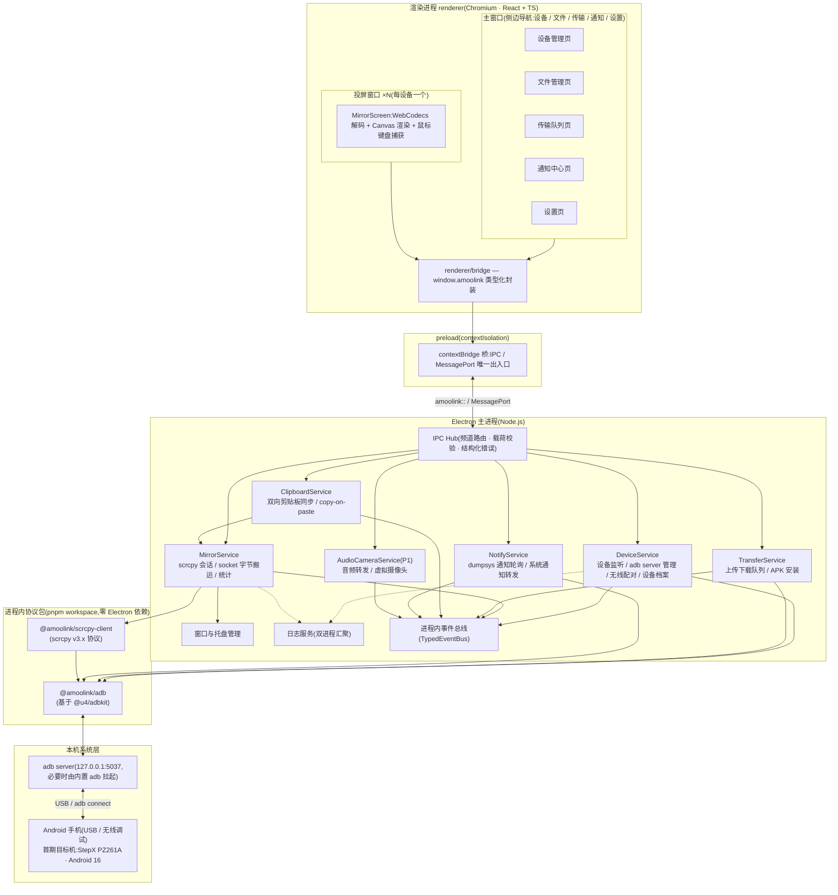
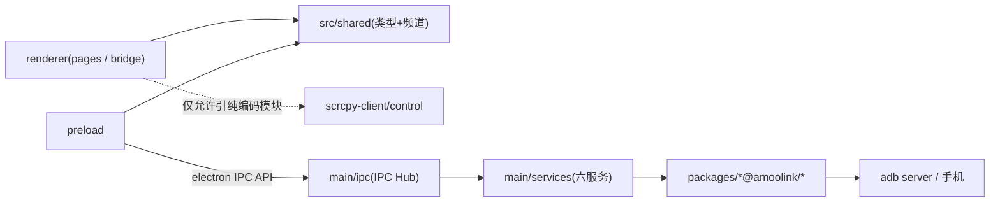
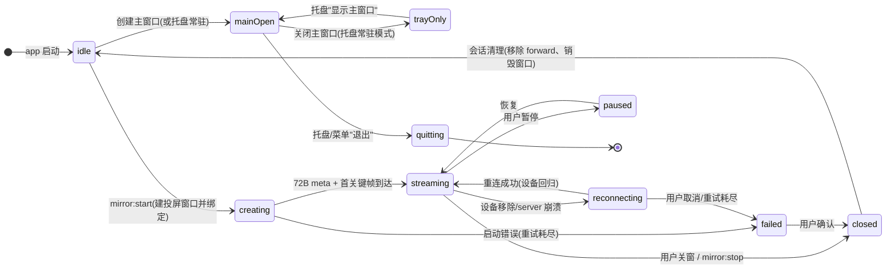

# AmooLink 系统架构设计

> 文档编号:02 | 状态:v1.0(2026-10-26)| 关联:[PLAN.md](../PLAN.md)、[01-产品需求与功能清单](./01-产品需求与功能清单.md)、[03-核心技术方案](./03-核心技术方案\(scrcpy协议与ADB通路\).md)
>
> 本文回答"系统怎么搭":进程模型、IPC 契约、模块边界、目录结构、数据结构、窗口体系、双平台策略、错误处理与日志。协议字节级细节见 docs/03。

---

## 1. 架构总览

### 1.1 总览图



### 1.2 分层说明

| 层 | 位置 | 职责 | 明确不做的事 |
|---|---|---|---|
| 表现层 | `renderer` | 页面 UI、投屏画布(解码/渲染/输入捕获)、状态管理 | 不触碰 adb、socket、Node API |
| 桥接层 | `preload` | contextBridge 收敛所有跨进程调用,提供类型化 API | 不含业务逻辑 |
| 服务层 | `main/services` | 六大服务:设备、投屏、传输、剪贴板、通知、音频摄像头 | 不直接操作 DOM |
| 协议层 | `packages/adb`、`packages/scrcpy-client` | ADB 命令封装、scrcpy 协议编解码与 socket 客户端 | 不依赖 Electron、不了解业务 |
| 系统层 | 本机 adb server + 手机 | adb 协议服务端、scrcpy-server 运行时 | — |

### 1.3 设计原则

1. **设备通道唯一化**:全应用只有主进程持有 adb 连接与 scrcpy socket。渲染进程一律通过 IPC/MessagePort 获取数据,保证序列化、可审计、可复用(未来 CLI/伴侣 APK 网关可直接复用服务层)。
2. **契约先行**:三端(主/预载/渲染)共享 TypeScript 类型,IPC 频道与载荷集中声明、集中校验,编译期与运行期双重约束。
3. **服务自治**:六大服务互不直接 import,通过进程内事件总线(TypedEventBus)协作;任一服务崩溃或不可用不影响其余服务(见 §8.3 降级矩阵)。
4. **高频数据走专用通道**:投屏视频/音频字节流与控制消息不走普通 `invoke`,走 MessagePort + Transferable,避免 IPC 序列化开销与主窗口卡顿。
5. **协议包零 Electron 依赖**:`@amoolink/adb` 与 `@amoolink/scrcpy-client` 可在纯 Node 环境(脚本、单测)独立运行。
6. **平台差异收敛**:所有 OS 差异封装在 `PlatformCapability` 之后,业务代码不出现 `process.platform` 分支(打包配置除外)。

---

## 2. 进程模型与 IPC 设计

### 2.1 三端职责边界

| 进程 | 运行时 | 职责 | 禁止事项 |
|---|---|---|---|
| 主进程 `src/main` | Node.js | app 生命周期;窗口/托盘;六大服务;adb/scrcpy socket;文件 IO;系统剪贴板;系统通知;日志落盘 | 不渲染 UI;不解析码流(WebCodecs 在渲染进程) |
| preload `src/preload` | 隔离环境 | `contextBridge.exposeInMainWorld('amoolink', …)`;转发 invoke/事件/MessagePort;类型与运行时守卫 | 不写业务逻辑;不开 `nodeIntegration` |
| 渲染进程 `src/renderer` | Chromium | React 页面;投屏窗口内 WebCodecs 解码 + Canvas 绘制 + 输入事件生成(调用 `@amoolink/scrcpy-client` 的**纯编码模块**把输入编码为控制消息字节) | 不 import `electron`、`node:*`、`@amoolink/adb`;不 `new net.Socket` |

> 说明:投屏窗口需要在渲染进程内做 Annex-B 拆分与控制消息编码(纯计算,无 IO)。`@amoolink/scrcpy-client` 通过 package.json `exports` 拆分子入口:`/control`(纯函数,渲染进程可用)与 `/transport`(Node net,仅主进程可用),从机制上防止渲染进程触碰 socket。

### 2.2 类型化 IPC 规范

**频道命名**:`amoolink:<domain>:<action>`

- `domain ∈ app | device | mirror | transfer | clipboard | notify | avcam | window`
- `action` 使用小驼峰动词或名词(`list`、`start`、`setConfig`…)
- 频道字符串只在 `src/main/ipc/channels.ts` 定义一次,preload 与渲染侧 import 常量,禁止裸写字符串

**两类通信**:

1. **请求-响应**:`ipcRenderer.invoke` ↔ `ipcMain.handle`,带超时(默认 15s,长任务由服务层转事件汇报进度)。返回统一信封:

```ts
/** src/shared/ipc.ts —— 三端共享 */
export interface IpcOk<T>  { ok: true;  data: T }
export interface IpcError  { code: string; message: string; detail?: unknown }
export type IpcResult<T>   = { ok: true; data: T } | { ok: false; error: IpcError };

/** 事件订阅载荷(main → renderer,webContents.send) */
export interface IpcEvent<T> { topic: string; ts: number; payload: T }
```

2. **事件订阅**:主进程 `webContents.send(topic, payload)`;preload 提供 `on(topic, cb)` 返回**反订阅函数**,避免渲染侧监听泄漏;服务层负责在窗口销毁时停止推送。

**第三类:高频二进制通道(投屏专用)**

- 普通事件每次序列化,不适合 8Mbps 视频 + 60Hz 触摸事件。投屏会话建立时,主进程创建 `MessageChannelMain`,`port1` 发给投屏窗口、`port2` 由 MirrorService 持有:
  - 视频/音频字节:`port.postMessage({ t: 'video', ts }, [chunk.buffer])`,以 Transferable **转移所有权**,近似零拷贝;
  - 控制消息(触摸/按键/滚轮):`port.postMessage({ t: 'ctrl', bytes })`,fire-and-forget,主进程收到后直接 `socket.write`,无回程开销;
  - 反压:主进程监测 port 队列水位(>8MB 暂停 socket,drain 后恢复),防止渲染端解码积压拖垮主进程。

**载荷 schema 校验**:编译期靠共享类型;运行期由 `src/main/ipc/schema.ts` 的手写 Type Guard 校验(不引第三方校验库),未知/非法载荷返回 `code: 'IPC_BAD_PAYLOAD'` 并记录告警日志。事件载荷同样校验(渲染侧不可信)。

### 2.3 IPC 频道清单(v1 冻结)

| 频道 | 类型 | 载荷(请求) | 返回/事件载荷 |
|---|---|---|---|
| `amoolink:app:getConfig` | req | — | `AppConfig` |
| `amoolink:app:setConfig` | req | `Partial<AppConfig>` | `AppConfig` |
| `amoolink:device:list` | req | — | `DeviceInfo[]` |
| `amoolink:device:refresh` | req | `{ serial?: string }` | `DeviceInfo[]` |
| `amoolink:device:pairWireless` | req | `{ host: string; pairPort: number; code: string }` | `{ ok: true }` |
| `amoolink:device:connectWireless` | req | `{ host: string; port: number }` | `{ serial: string }` |
| `amoolink:device:enableTcpip` | req | `{ serial: string }` | `{ port: 5555 }` |
| `amoolink:mirror:start` | req | `{ serial: string; params?: Partial<MirrorParams> }` | `MirrorSession` |
| `amoolink:mirror:stop` | req | `{ sessionId: string }` | `void` |
| `amoolink:mirror:updateParams` | req | `{ sessionId: string; params: Partial<MirrorParams> }` | `MirrorSession`(内部重启会话) |
| `amoolink:mirror:action` | req | `{ sessionId: string; action: 'home'\|'back'\|'appSwitch'\|'power'\|'volumeUp'\|'volumeDown'\|'expandNotifications'\|'expandSettings'\|'collapsePanels'\|'screenOn' }` | `void` |
| `amoolink:mirror:screenshot` | req | `{ sessionId?: string; serial: string; save?: boolean }` | `{ pngBase64: string; savedPath?: string }` |
| `amoolink:transfer:enqueueUpload` | req | `{ serial: string; localPaths: string[]; targetDir: string }` | `TransferTask[]` |
| `amoolink:transfer:enqueueDownload` | req | `{ serial: string; devicePaths: string[]; targetDir?: string }` | `TransferTask[]` |
| `amoolink:transfer:pause` / `:resume` / `:cancel` / `:retry` | req | `{ taskId: string }` | `TransferTask` |
| `amoolink:transfer:listDir` | req | `{ serial: string; path: string }` | `DirEntry[]` |
| `amoolink:transfer:installApk` | req | `{ serial: string; localPath: string }` | `{ ok: true; output: string }` |
| `amoolink:clipboard:getHistory` / `:clearHistory` | req | — / `{ ids?: string[] }` | `ClipboardPayload[]` / `void` |
| `amoolink:notify:pollNow` | req | `{ serial: string }` | `NotificationItem[]` |
| `amoolink:notify:setMuted` | req | `{ serial: string; packageName: string; muted: boolean }` | `void` |
| `amoolink:avcam:start` / `:stop`(P1) | req | `{ serial: string; cameraId?: 'back'\|'front' }` | `void` |
| `amoolink:window:openMirror` | req | `{ sessionId: string }` | `void` |
| `amoolink:device:changed` | event | — | `{ type: 'add'\|'update'\|'remove'; device: DeviceInfo }` |
| `amoolink:mirror:state` | event | — | `{ sessionId: string; state: MirrorState; stats: MirrorStats }` |
| `amoolink:transfer:changed` | event | — | `{ task: TransferTask }` |
| `amoolink:clipboard:synced` | event | — | `{ payload: ClipboardPayload }` |
| `amoolink:notify:new` | event | — | `{ item: NotificationItem }` |
| `amoolink:app:log` | event(渲染→主) | — | `{ level; message; context? }`(渲染进程日志汇聚) |

### 2.4 preload 桥实现骨架

```ts
// src/preload/index.ts(节选)
import { contextBridge, ipcRenderer } from 'electron';
import { CHANNELS } from '../shared/ipc';

async function invoke<T>(channel: string, payload?: unknown): Promise<T> {
  const res = await ipcRenderer.invoke(channel, payload);
  if (res && res.ok === false) throw Object.assign(new Error(res.error.message), res.error);
  return res.data as T;
}

contextBridge.exposeInMainWorld('amoolink', {
  device: {
    list: () => invoke<DeviceInfo[]>(CHANNELS.deviceList),
    pairWireless: (p: PairArgs) => invoke<...>(CHANNELS.devicePair, p),
    // …见 channels.ts 全量映射
  },
  /** 事件订阅,返回反订阅函数 */
  on<T>(topic: string, cb: (payload: T) => void): () => void {
    const listener = (_e: Electron.IpcRendererEvent, p: T) => cb(p);
    ipcRenderer.on(topic, listener);
    return () => ipcRenderer.off(topic, listener);
  },
  /** 投屏窗口专用:接收主进程下发的 MessagePort */
  onMirrorPort(cb: (port: MessagePort, sessionId: string) => void): void {
    ipcRenderer.on(CHANNELS.mirrorPort, (e, meta) => {
      const [port] = e.ports;
      port.start();
      cb(port, meta.sessionId as string);
    });
  },
});

export type AmoolinkBridge = typeof globalThis.amoolink; // 供 renderer/bridge 复用类型
```

主进程侧端口下发(窗口创建后):

```ts
// src/main/services/MirrorService.ts(节选)
const { port1, port2 } = new MessageChannelMain();
mirrorWin.webContents.postMessage(CHANNELS.mirrorPort, { sessionId }, [port1]);
// port2 由 MirrorSession 持有:video socket data → port2.postMessage(transfer);
// port2.onmessage = (ctrl 消息) → controlSocket.write(bytes)
```

---

## 3. 模块划分与依赖方向

### 3.1 主进程六大服务

| 服务 | 职责 | 依赖包 | 关键内部状态 | 对外事件(进程内总线) |
|---|---|---|---|---|
| **DeviceService** | adb server 连接/自动拉起;`trackDevices` 热插拔;无线配对(`adb pair`)与 `tcpip 5555`;设备档案采集与缓存(getprop/wm/battery/df,电量 5s、存储 30s 增量刷新);设备增删改广播 | `@amoolink/adb` | `Map<serial, DeviceInfo>`、tracker 实例 | `device:added/updated/removed`、`adbServer:down/up` |
| **MirrorService** | 投屏会话生命周期;推送 scrcpy-server.jar、端口 forward、`app_process` 拉起;持有视频/音频/控制 socket 并与投屏窗口 MessagePort 互通;fps/码率/延迟统计;会话重连 | `@amoolink/scrcpy-client`、`@amoolink/adb` | `Map<sessionId, MirrorSession>` | `mirror:sessionStarted/stateChanged/closed` |
| **TransferService** | 上传/下载队列(并发 2)、暂停/恢复/取消/重试、进度节流(200ms)、命名冲突策略(重命名默认)、APK 流式安装、完成后打开目录 | `@amoolink/adb` | `Map<taskId, TransferTask>`、队列 | `transfer:taskChanged` |
| **ClipboardService** | 电脑侧剪贴板轮询(500ms,文本 hash+图片指纹);电脑→手机 `SET_CLIPBOARD`+ack 等待;手机→电脑订阅投屏控制通道 clipboard 消息;copy-on-paste;本地历史(上限 100 条) | 事件总线(依赖 MirrorService 会话)+ Electron clipboard | 历史环形缓冲、seq 计数器 | `clipboard:synced` |
| **NotifyService** | `dumpsys notification --noredact` 轮询(1.5s,可调 1–2s);key/pkg/text/when 解析与 diff;Electron Notification 转发;点击聚焦/拉起投屏;按 App 免打扰 | `@amoolink/adb` | `Map<key, NotificationItem>` | `notify:itemNew/itemRemoved` |
| **AudioCameraService**(P1) | 音频转发(投屏会话音频 socket → 投屏窗口 WebAudio 播放/独立小窗);虚拟摄像头源输出(P1 后期,平台适配层) | MirrorService 会话 + 平台适配 | 会话绑定关系 | `avcam:started/stopped` |

剪贴板同步依赖**活跃投屏会话**的控制通道(scrcpy SET/GET 剪贴板只能走该通道);无会话时该功能自动置为不可用并在 UI 提示,二期伴侣 APK 补齐无会话通路。

### 3.2 依赖规则与方向图



附加禁令(图中虚线未尽事项):`renderer/**` 禁止 import `electron`、`node:*`、`@amoolink/adb`、`node:net`。

规则清单(eslint `no-restricted-imports` 强制):

1. `renderer/**` 只允许 import:`react`、`renderer/bridge`、`renderer/pages`、`renderer/styles`、`src/shared`、`@amoolink/scrcpy-client/control`;
2. `preload/**` 只允许 import:`electron`、`src/shared`;
3. `main/services/**` 之间禁止横向 import,跨服务协作一律走 TypedEventBus;
4. `packages/**` 禁止 import `electron` 与业务代码;`scrcpy-client/transport`(含 `node:net`)禁止被 renderer/preload 引用;
5. `src/main/ipc` 只做路由与校验,不含业务逻辑;服务层不 import `ipc` 模块(单向依赖)。

### 3.3 进程内事件总线

`src/main/services/bus.ts`:类型化 `EventEmitter`,topic 与载荷类型在 `src/shared/events.ts` 声明。示例:DeviceService 检测到设备移除 → 发 `device:removed` → MirrorService 监听后停止对应会话、TransferService 暂停任务、NotifyService 停止轮询、ClipboardService 标记不可用。服务注册顺序在 `main/index.ts` 显式声明,避免隐式初始化依赖。

---

## 4. monorepo 目录结构

```text
AmooLink/
├── PLAN.md / TODO.md / README.md
├── pnpm-workspace.yaml            # packages: apps/*, packages/*
├── package.json                   # 根脚本:dev / typecheck / build / lint
├── tsconfig.base.json             # 严格模式,project references
├── .npmrc                         # registry=https://registry.npmmirror.com
├── docs/                          # 六份设计文档(本文档所在)
├── apps/
│   └── desktop/                   # @amoolink/desktop(Electron 应用壳)
│       ├── package.json
│       ├── electron.vite.config.ts
│       ├── electron-builder.yml   # darwin-arm64 / win nsis
│       ├── scripts/check-device.ts# 真机冒烟测试(直接调用 packages,不经 UI)
│       └── src/
│           ├── main/
│           │   ├── index.ts       # app 生命周期、服务装配、托盘
│           │   ├── services/      # DeviceService / MirrorService / TransferService /
│           │   │                  # ClipboardService / NotifyService / AudioCameraService
│           │   │                  # bus.ts / platform/(平台差异收敛)
│           │   └── ipc/           # index.ts(路由注册) channels.ts(频道常量) schema.ts(载荷守卫)
│           ├── preload/
│           │   └── index.ts       # contextBridge 类型化桥
│           ├── renderer/
│           │   ├── pages/         # devices / files / transfers / notifications / settings / mirror
│           │   ├── bridge/        # window.amoolink 封装、useDeviceList/useTransferQueue 等 hooks
│           │   └── styles/        # design tokens、全局样式、暗色主题
│           └── shared/            # (补充目录)三端共享:types.ts / ipc.ts / events.ts
├── packages/
│   ├── adb/                       # @amoolink/adb
│   │   ├── package.json
│   │   └── src/
│   │       ├── AdbClient.ts       # AdbServerClient 封装:server 拉起/重试/shell/push/pull/forward
│   │       ├── DeviceManager.ts   # trackDevices 状态机 + 设备档案
│   │       ├── props.ts           # getprop 白名单 / wm / battery / df 解析
│   │       ├── wireless.ts        # 内置 adb 二进制 spawn:pair / connect / tcpip
│   │       └── types.ts
│   └── scrcpy-client/             # @amoolink/scrcpy-client
│       ├── package.json           # exports: "./control"(纯函数)与 "./transport"(node:net)
│       └── src/
│           ├── client.ts          # ScrcpyClient:启动编排、socket、生命周期
│           ├── protocol/
│           │   ├── constants.ts   # 消息类型常量冻结(见 docs/03)
│           │   ├── controlEncoder.ts   # 控制消息编码(上行,纯函数)
│           │   ├── deviceMessageDecoder.ts # 设备消息解析(下行,粘包安全)
│           │   └── meta.ts        # 首 socket 72 字节元数据解析
│           ├── transport/
│           │   ├── sockets.ts     # 视频/音频/控制 socket 建立与读写(仅主进程)
│           │   └── serverLauncher.ts # push/forward/app_process 编排
│           └── types.ts
└── resources/                     # 随包分发(electron-builder asarUnpack)
    ├── scrcpy-server.jar          # Apache-2.0,保留版权声明
    └── adb/
        ├── darwin-arm64/adb
        └── win32-x64/adb.exe
```

构建链:`electron-vite`(主/预载/渲染三构建)+ `electron-builder` 打包;`packages/*` 以 TS 源码被 workspace 直接引用(electron-vite 编译期打包,不预编译),单测用 `vitest` 直接跑 Node 环境。

---

## 5. 关键数据结构

定义于 `apps/desktop/src/shared/types.ts`(三端共享;`packages/*` 自带协议层类型,服务层负责映射,反向不依赖)。

```ts
// ============ 设备 ============
export type Transport = 'usb' | 'tcpip';

export interface BatteryInfo {
  level: number;                                  // 0–100
  status: 'charging' | 'discharging' | 'full' | 'notCharging' | 'unknown';
  powered: 'ac' | 'usb' | 'wireless' | null;      // 当前供电来源
}

export interface StorageInfo {
  totalBytes: number;
  usedBytes: number;
  availBytes: number;                             // df /data
}

export interface DeviceInfo {
  serial: string;              // adb 序列号(USB 形如 "serialNo";无线形如 "192.168.x.x:5555")
  transport: Transport;
  state: 'device' | 'offline' | 'unauthorized';   // adb track-devices 状态
  name: string;                // 展示名,默认取 model
  model: string;               // ro.product.model,如 "PZ261A"
  brand: string;               // ro.product.brand
  manufacturer: string;        // ro.product.manufacturer
  device: string;              // ro.product.device
  androidVersion: string;      // ro.build.version.release,如 "16"
  sdkInt: number;              // ro.build.version.sdk,如 36
  screenWidth: number;         // wm size(Override 优先),如 1200
  screenHeight: number;        // 如 2670
  densityDpi: number;          // wm density,如 520
  battery?: BatteryInfo;
  storage?: StorageInfo;
  wireless?: { host: string; port: number; pairedAt?: number };  // 仅 tcpip
  firstSeenAt: number;         // epoch ms
  lastUpdatedAt: number;
}

// ============ 投屏会话 ============
export type MirrorState =
  | 'starting'      // push/forward/app_process/建连中
  | 'streaming'     // 首帧后
  | 'paused'        // 用户暂停
  | 'reconnecting'  // 断线重连中
  | 'closed'
  | 'error';

export interface MirrorParams {
  maxSize: number;             // 短边上限;0 = 原生分辨率。默认 1600
  videoBitRate: number;        // bps。默认 8_000_000
  maxFps: number;              // 0 = 不限。默认 60
  videoCodec: 'h264' | 'h265'; // 按解码支持探测结果默认
  audio: boolean;              // Android 11+ 生效
  control: boolean;            // 反控开关(只投屏时可关)
  stayAwake: boolean;
  turnScreenOff: boolean;      // 黑屏模式
}

export interface MirrorStats {
  fps: number;                 // 1Hz 统计
  bitrateKbps: number;
  latencyMs: number | null;    // 渲染侧估算(可选,首期可 null)
  droppedFrames: number;       // 因反压丢弃的帧
  videoQueueDepth: number;     // 渲染侧待解码深度
}

export interface MirrorSession {
  id: string;                  // UUID,即 IPC 中的 sessionId
  deviceSerial: string;
  state: MirrorState;
  params: MirrorParams;
  meta: { deviceName: string; width: number; height: number }; // 首 socket 64B 名称 + u32 宽高
  localPort: number;           // adb forward 分配的本机 TCP 端口
  stats: MirrorStats;
  createdAt: number;
  windowId: number | null;
  lastError?: { code: string; message: string };
}

// ============ 文件传输 ============
export type TransferDirection = 'upload' | 'download';
export type TransferState =
  | 'queued' | 'running' | 'paused' | 'done' | 'error' | 'canceled';

export interface TransferTask {
  id: string;                  // UUID
  direction: TransferDirection;
  deviceSerial: string;
  localPath: string;           // 上传源 / 下载目标(绝对路径)
  devicePath: string;          // 上传目标 / 下载源(设备绝对路径)
  fileName: string;
  totalBytes: number;          // 目录任务为聚合值
  transferredBytes: number;
  state: TransferState;
  speedBps: number;            // EMA 平滑
  error?: string;
  isApkInstall?: boolean;      // APK 上传完成后立即 pm install
  createdAt: number;
  startedAt?: number;
  finishedAt?: number;
}

export interface DirEntry {    // transfer:listDir 返回
  name: string;
  path: string;
  isDir: boolean;
  size: number;
  modifiedAt: number | null;
}

// ============ 剪贴板 ============
export interface ClipboardPayload {
  id: string;
  source: 'phone' | 'desktop';
  kind: 'text' | 'image';
  text?: string;               // kind=text
  imagePng?: Uint8Array;       // kind=image(IPC 中以 base64 传输;MessagePort 可转移)
  byteLength: number;          // 文本 UTF-8 字节数或 PNG 字节数
  sequence: number;            // 与 scrcpy SET_CLIPBOARD/ack 的 sequence 对齐
  createdAt: number;
}

// ============ 通知 ============
export interface NotificationItem {
  key: string;                 // dumpsys 通知记录主键,如 "0|com.x.y|123|-1|10000"
  packageName: string;
  userId: number;              // 默认 0
  title?: string;              // extras android.title
  text?: string;               // extras android.text(--noredact 下可得)
  when: number;                // epoch ms,extras android.when
  isOngoing: boolean;          // 常驻通知(来电/播放)标记
  isClearable: boolean;
  firstSeenAt: number;         // 首次被本端发现的时间
  updatedAt: number;           // 内容 hash 变化时刷新
}
```

序列化约定:IPC(结构化克隆)可直接传 `Uint8Array`;普通 JSON 场景(历史落盘)对二进制字段用 base64。

---

## 6. 窗口体系

### 6.1 窗口清单

| 窗口 | 数量 | 尺寸 | 导航/内容 | 备注 |
|---|---|---|---|---|
| 主窗口 | 1(单例) | 默认 1080×720,min 880×600 | 侧边导航五项:**设备 / 文件 / 传输 / 通知 / 设置** | `titleBarStyle: hiddenInset`(mac);Windows 常规标题栏;关闭行为见 §6.2 |
| 投屏窗口 | 每活跃 `MirrorSession` 一个 | 按 meta 宽高比自适应(如 1200:2670 → 424×944 逻辑尺寸起),min 240×360 | `pages/mirror`:Canvas + 悬浮工具条(Home/返回/多任务/音量/锁屏/全屏/置顶/黑屏/截图/录屏) | `alwaysOnTop` 可选;支持全屏;多设备可同时投屏 |
| 托盘 | 1 | — | 菜单:显示主窗口、每设备"开始/停止投屏"、传输中心、设置、退出 | `Tray` + `Menu`;mac 菜单栏 / win 系统托盘 |

### 6.2 窗口生命周期



规则:

- **主窗口**:关闭默认最小化到托盘(`settings.closeToTray`,默认 true),托盘"退出"才真正退出;退出前遍历会话逐个 `mirror:stop`(清理 forward、杀 server)。
- **投屏窗口**:窗口关闭 ⇒ 对应会话 `stop`(录屏进行中弹确认);会话 `closed/error` ⇒ 窗口自动关闭;会话 `reconnecting` ⇒ 窗口保留并显示重连遮罩,用户可取消。
- **窗口与会话绑定**:`MirrorSession.windowId` 记录归属;`webContents.destroyed` 时若会话仍在则触发 stop,防止孤儿会话占用 socket。
- 多显示器与 DPI:投屏窗口按 `display` 缩放因子设置 Canvas 物理像素(见 docs/03 §3.5);窗口在屏幕间拖动时监听 `move` 事件重算 DPR。

### 6.3 托盘与开机自启

托盘图标随"有无活跃设备/会话"切换(在线/投屏/离线三态);`app.setLoginItemSettings` 实现开机自启(设置项,默认关)。

---

## 7. 双平台策略

### 7.1 打包(electron-builder)

```yaml
# apps/desktop/electron-builder.yml(要点)
appId: com.amoolink.desktop
productName: AmooLink
asar: true
asarUnpack:                      # 二进制与 jar 不进 asar,保证 spawn/读取
  - resources/adb/**
  - resources/scrcpy-server.jar
mac:
  target: [{ target: dmg, arch: [arm64] }]   # darwin-arm64;暂不打 x64/universal
  category: public.app-category.utilities
  hardenedRuntime: true
  entitlements: build/entitlements.plist     # JIT(harmless)/no-sandbox 不需要额外权限
win:
  target: [{ target: nsis, arch: [x64] }]
nsis:
  oneClick: false
  allowToChangeInstallationDirectory: true
  artifactName: AmooLink-Setup-${version}.${ext}
```

- CI/本地构建统一走国内镜像:`ELECTRON_MIRROR=https://npmmirror.com/mirrors/electron/`、`ELECTRON_BUILDER_BINARIES_MIRROR=https://npmmirror.com/mirrors/electron-builder-binaries/`。
- macOS 发布需签名 + 公证(Developer ID);Windows 一期免签名(SmartScreen 提示写入 README),预留 `signtool` 配置位。
- 架构保持可扩展:目标数组与 `resources/adb/<platform>-<arch>/` 命名规则已为 Linux/其他架构预留,不在本期打包。

### 7.2 平台差异点清单

| 能力 | macOS(darwin-arm64) | Windows(x64 nsis) | 收敛方式 |
|---|---|---|---|
| 剪贴板监听 | 无系统变更通知 → 主进程 500ms 轮询(readText hash + 图片尺寸/字节指纹) | 同左(后续可用原生 `AddClipboardFormatListener` 模块优化,一期不引入原生依赖) | `ClipboardService` 统一实现,平台仅影响注释级差异 |
| 系统通知 | `Electron Notification`;未签名时横幅可受专注模式影响 | 必须先 `app.setAppUserModelId(process.execPath)`,否则不弹/无正确来源 | `platform/winNotify.ts` 启动时设置;其余统一 API |
| 打开目录/文件 | `shell.showItemInFolder`(open -R) | `explorer /select,`(同 API 内部处理) | 统一走 `shell.showItemInFolder` |
| 虚拟摄像头(P1) | 需签名+公证的 CMIO 系统扩展,成本高 | 需虚拟摄像头驱动(自研成本高) | 一期**不做驱动**:优先适配 OBS Virtual Camera(检测注册表/IOKit 后输出到其文件/共享内存);原生驱动列为二期评估 |
| 托盘 | 菜单栏模板图需 @2x | 系统托盘 ico | 两套图标资源,`platform/` 选择 |
| adb 二进制 | `resources/adb/darwin-arm64/adb`(gatekeeper:随 dmg 签名) | `resources/adb/win32-x64/adb.exe` | `AdbClient` 按 `process.platform`-`process.arch` 定位 |
| 路径/文件名 | 大小写不敏感、`/` | 大小写敏感、`\`;设备侧始终 `/` | 本地路径全部 `path.*` API 拼接,禁止字符串拼接分隔符 |
| 默认接收目录 | `~/Downloads/AmooLink` | `%USERPROFILE%\Downloads\AmooLink` | `app.getPath('downloads')` + 固定子目录 |
| 黑屏模式后点亮 | shell `input keyevent 223` 灭屏;控制消息 6(action=1)点亮 | 同左(通路与平台无关) | 见 docs/03 §2.4 |

### 7.3 共性策略

- 时间与日志统一 UTC 存储、显示本地化;剪贴板/通知文本一律按 UTF-8。
- UI 全量使用逻辑像素 + CSS 变量,两平台由 Chromium 保证一致;仅交互习惯差异(mac:cmd 快捷键,win:ctrl)在快捷键表(accelerator)中分平台声明。

---

## 8. 错误处理与日志体系

### 8.1 分级日志

- 等级:`trace < debug < info < warn < error`;生产默认 `info`,设置页可调,排查问题时可切 `debug` 并一键导出最近日志。
- 双进程汇聚:主进程 Logger 直接落盘;渲染进程经 `amoolink:app:log` 事件汇聚到主进程落盘(自动附带页面/组件上下文)。
- 落盘:`userData/logs/amoolink-main-YYYYMMDD.log`,按天滚动,单文件超 10MB 切分,保留最近 7 天;dev 额外输出 console。
- 脱敏:设备 serial 默认哈希化(设置"诊断模式"开关后输出明文);日志永不记录剪贴板内容与通知正文,只记长度/hash。
- 每条日志结构:`{ ts, level, scope(服务/模块), event, data?, err? }`,便于按事件聚合。

### 8.2 设备连接异常恢复

| 故障 | 检测 | 恢复动作 |
|---|---|---|
| adb server 未启动/崩溃 | AdbClient 任意调用 `ECONNREFUSED` | ① 广播 `adbServer:down`,UI 全局横幅"连接服务重启中" → ② spawn 内置 `adb start-server`(最多 3 次,间隔 1s/2s/4s)→ ③ 端口就绪后重建 tracker、恢复设备列表 → ④ 广播 `adbServer:up`;期间会话标记 `reconnecting` |
| 设备拔出 / 无线断开 | `trackDevices` remove | 立即:停 MirrorSession(不杀 UI,窗口转重连遮罩)、暂停 Transfer 队列、停通知轮询、剪贴板置不可用;设备档案保留 5 分钟供"重新插入自动恢复" |
| 设备回归(同 serial) | tracker add(且之前 5 分钟内移除) | 自动恢复:传输队列续传;投屏按用户设置(`autoResumeMirror`,默认关)自动重开;通知轮询重启 |
| `unauthorized` | tracker 状态 | UI 引导"手机上勾选一律允许";授权成功(state→device)自动继续 |
| scrcpy-server 崩溃 | shell 流 exit code ≠ 0 / stderr 异常 | 解析 server 日志(权限/编码器错误分类);指数退避重试 ≤3 次(1s/2s/4s);耗尽后会话 `error` 并给出原因 |
| 无线抖动 | 5s 心跳(shell echo)超时 ×2 | 主动 `adb disconnect` → 重连一次;失败则按设备移除流程处理 |
| WebCodecs 不可用/编码不支持 | `isConfigSupported` 探测 | 见 §8.3 降级矩阵 |

### 8.3 服务降级矩阵

| 能力 | 触发条件 | 降级行为 | UI 表现 |
|---|---|---|---|
| H.265 投屏 | 渲染端 `isConfigSupported(hvc1)` false | 自动改 H.264 重启会话 | 画质下拉提示"H.265 不可用" |
| 音频转发 | 设备 < Android 11 / 音频 socket 建立失败 | 会话降级为纯视频 | 投屏工具条隐藏音量图标 |
| 剪贴板同步 | 无活跃投屏会话 / ack 超时 | 暂停同步,保留手动"拉取一次" | 设备卡片置灰该项 |
| 通知同步 | dumpsys 解析失败 / 免打扰 | 本轮丢弃,保留上次快照;连续 5 次失败暂停 60s | 通知页显示"暂不可用" |
| copy-on-paste 拉取 | GET_CLIPBOARD 超时 1s | 放弃本次,提示"手机剪贴板读取失败" | toast |
| 文件传输 | 单文件 IO 错误 | 任务置 error,队列继续下一项;支持手动重试 | 传输页红条 |
| 虚拟摄像头 | 平台驱动缺失 | 提示安装 OBS Virtual Camera 或禁用该项 | 设置页禁用态 |

### 8.4 统一错误码(节选)

| code | 含义 | 典型来源 |
|---|---|---|
| `ADB_SERVER_UNREACHABLE` | adb server 无法拉起/连接 | AdbClient |
| `DEVICE_OFFLINE` / `DEVICE_UNAUTHORIZED` | 设备离线 / 未授权 | DeviceService |
| `FORWARD_FAILED` | 端口转发建立失败 | MirrorService |
| `SCRCPY_PUSH_FAILED` / `SCRCPY_SERVER_CRASH` | jar 推送失败 / server 退出 | MirrorService |
| `VIDEO_CODEC_UNSUPPORTED` | 编解码配置不支持 | 渲染进程探测 |
| `CLIPBOARD_ACK_TIMEOUT` | SET_CLIPBOARD 未收到 ack | ClipboardService |
| `TRANSFER_IO_ERROR` | 读写失败(磁盘满/权限/设备侧) | TransferService |
| `INSTALL_FAILED` | pm install 返回 Failure | TransferService |
| `IPC_BAD_PAYLOAD` | 载荷校验失败 | IPC Hub |

错误透传规则:协议包抛出的原始错误在服务层包装为 `{ code, message, detail }`;渲染层只消费 code 与已本地化的 message,`detail` 仅入日志。

### 8.5 进程级兜底

- `process.on('uncaughtException'/'unhandledRejection')`(主进程):记录 error 日志,弹一次性对话框("发生错误,已记录日志"),不静默退出;连续崩溃(10 分钟内 ≥3 次)下次启动进入安全模式(禁用 P1 服务,仅设备管理可用)。
- 渲染进程 `unresponsive`:主进程告警日志 + 该窗口渲染进程自动 reload(投屏会话不中断,重连 MessagePort)。

---

## 9. 与其他文档的关系

| 主题 | 文档 |
|---|---|
| 产品范围与验收(P0/P1 清单) | docs/01 |
| adb 命令细节、scrcpy 字节级协议、解码管线、剪贴板/截图/通知/传输通路 | **docs/03(核心)** |
| 伴侣 APK(二期) | docs/04 |
| 安全与隐私(USB 调试风险、无线配对、日志脱敏细化) | docs/05 |
| 里程碑与验收 | docs/06 |
