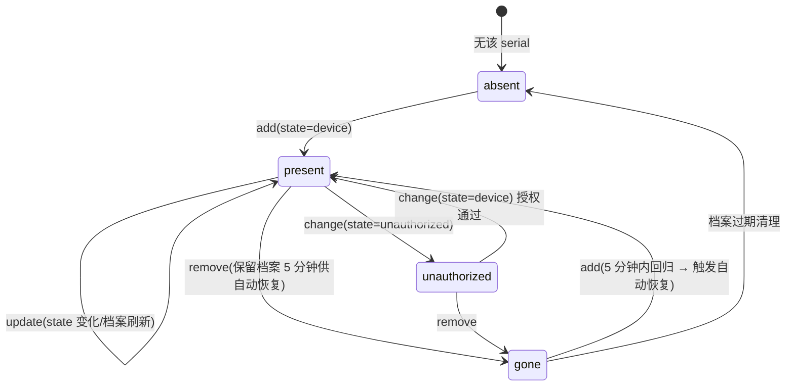
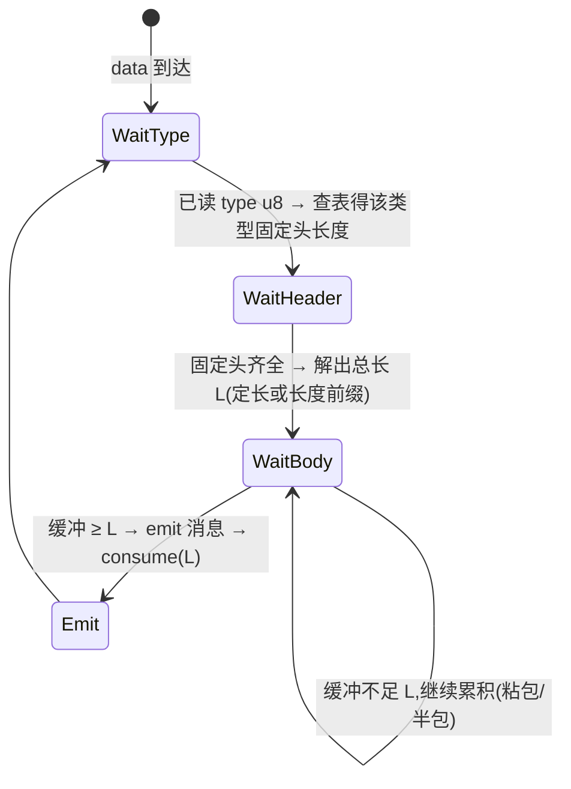
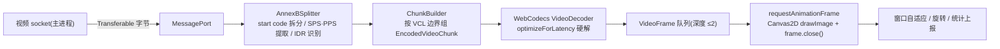
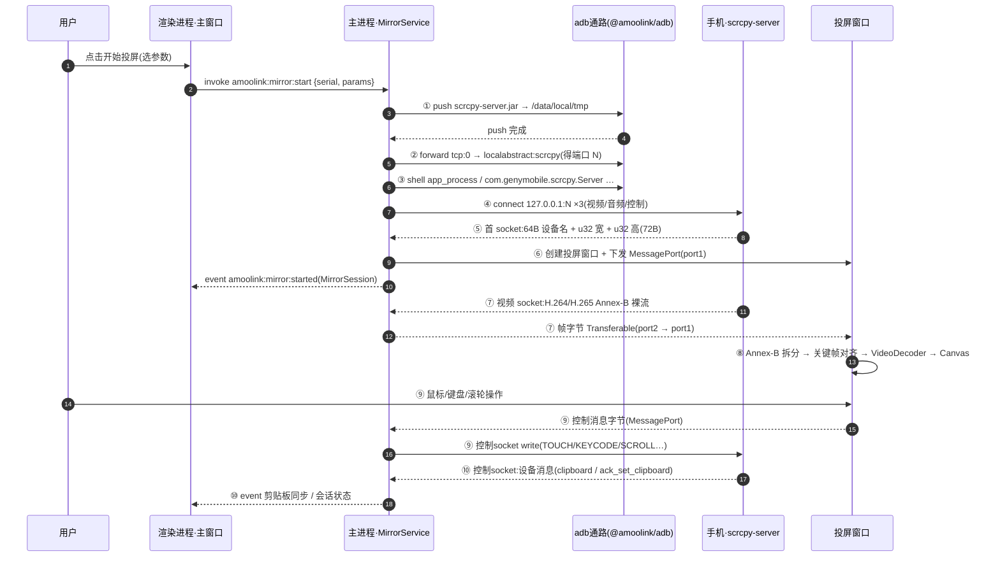
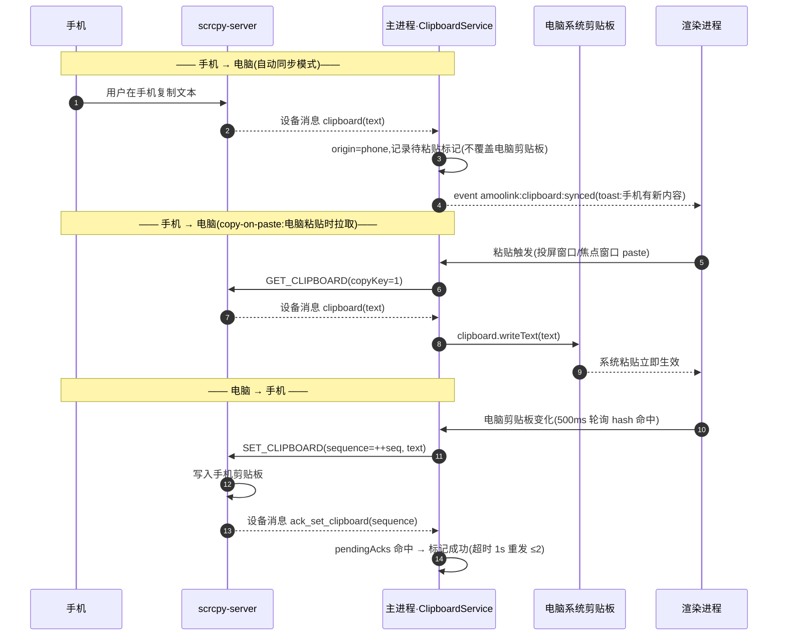
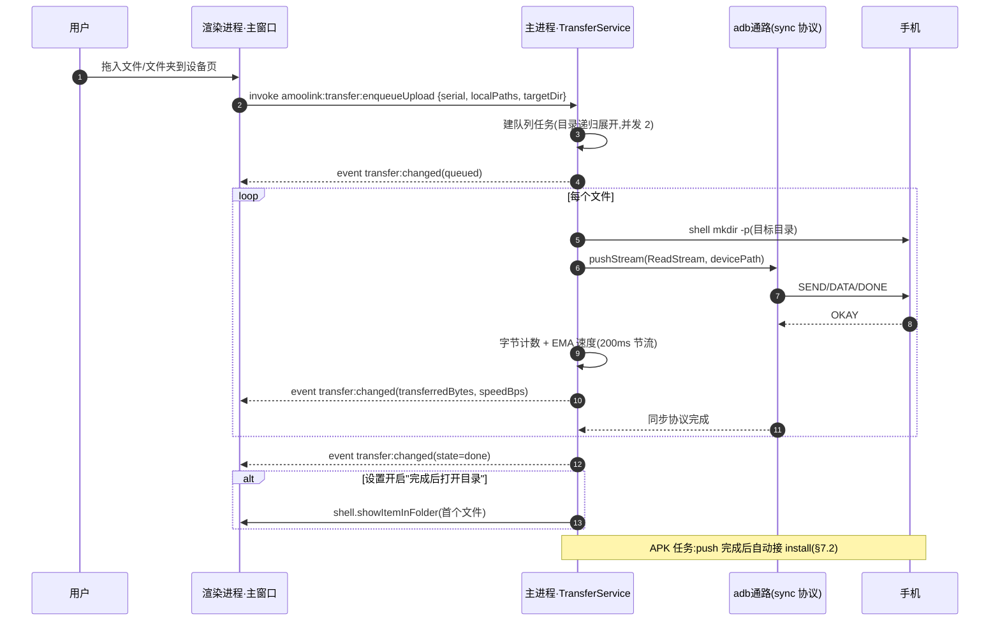

# AmooLink 核心技术方案(scrcpy 协议与 ADB 通路)

> 文档编号:03 | 状态:v1.0(2026-10-26)| 关联:[02-系统架构设计](./02-系统架构设计.md)
>
> 本文是全项目最核心的技术文档,目标深度:**对照本文可直接开始编码**。覆盖 `packages/adb` 与 `packages/scrcpy-client` 两个包的全部协议细节,以及视频管线、剪贴板、截图、通知、文件传输五条业务通路。

## 0. 事实基线与全局约定

| 项 | 值(实测) |
|---|---|
| 目标设备 | StepX PZ261A(USB / 无线调试均可) |
| 系统 | Android 16 / SDK 36 / arm64-v8a |
| 屏幕 | 1200×2670 @ 520dpi |
| 通路 | 本机 adb server(127.0.0.1:5037)+ 内嵌 scrcpy-server.jar(Apache-2.0) |

**全局约定:**

1. scrcpy 协议中所有多字节整数字段一律**大端**(Big-Endian),Node 侧统一使用 `writeUInt*BE / readUInt*BE` 系列方法。
2. 协议常量在 `packages/scrcpy-client/src/protocol/constants.ts` **冻结**(见 §2.1);`<version>` 参数必须与随包 `resources/scrcpy-server.jar` 版本严格一致,启动参数与消息编号若调整 server 版本需同步复核。
3. `@amoolink/scrcpy-client` 分两个导出入口:`/control`(纯函数编解码,渲染进程可引)与 `/transport`(Node `net`,仅主进程)。
4. 设备路径一律绝对路径(`/sdcard/...`、`/data/local/tmp/...`);桌面路径由主进程处理。

---

## 1. ADB 通路层(packages/adb)

### 1.1 设计总览与 adb server 生命周期

`@amoolink/adb` 基于 `@u4/adbkit`(纯 JS,Apache-2.0)封装,职责:

- 维持与本机 adb server(127.0.0.1:5037)的单例连接;server 不在时用**随包分发的内置 adb 二进制**拉起(`resources/adb/<platform>-<arch>/adb`);
- `trackDevices` 设备热插拔监听与状态机;
- 常用命令封装:`shell`、`shellBytes`(二进制安全的 exec-out)、`push`、`pull`、`forward`、无线配对;
- 设备信息采集(getprop / wm / dumpsys battery / df)与解析。

生命周期:`ensureServer()` 探活(`version` 命令)→ 失败则 `spawn(内置 adb, ['start-server'])` → 轮询端口就绪(≤5s)→ 建立 tracker。运行期任何 `ECONNREFUSED` 触发 docs/02 §8.2 的恢复流程(广播 `adbServer:down` → 重拉 → `adbServer:up`)。

### 1.2 @u4/adbkit 关键用法

> 以下为封装层视角的目标 API;`@u4/adbkit` 实际签名(如 forward 的参数形态)以其类型定义为准,差异全部在 `AdbClient` 内部吸收,业务层不感知。

```ts
// packages/adb/src/AdbClient.ts(核心骨架)
import { AdbServerClient } from '@u4/adbkit';
import { spawn } from 'node:child_process';
import { createReadStream } from 'node:fs';

export class AdbClient {
  private client = new AdbServerClient({ host: '127.0.0.1', port: 5037 });

  async ensureServer(): Promise<void> {
    try {
      await this.client.getVersion();                    // 探活:发送 host:version
    } catch {
      await this.spawnBundled(['start-server']);         // 内置二进制拉起
      await waitPort(5037, 5000);
    }
  }

  /** 设备增删监听(底层 host:track-devices 长连接) */
  async trackDevices(h: {
    onAdd(serial: string, state: string): void;
    onRemove(serial: string): void;
    onChange(serial: string, state: string): void;
    onError(err: Error): void;
  }) {
    const tracker = await this.client.trackDevices();
    tracker.on('add',    d => h.onAdd(d.serial, d.state));
    tracker.on('remove', d => h.onRemove(d.serial));
    tracker.on('change', d => h.onChange(d.serial, d.state));
    tracker.on('error',  h.onError);
    return tracker;   // 返回值携带 stop(),断线恢复时销毁重建
  }

  private device(serial: string) { return this.client.getDevice(serial); }

  /** shell 文本命令(输出聚合为字符串;仅用于文本,二进制走 shellBytes) */
  async shell(serial: string, cmd: string): Promise<string> {
    const stream = await this.device(serial).shell(cmd);
    return await readAllToUtf8(stream);
  }

  /** 二进制安全通道:exec-out(不做 \n → \r\n 转换,截图必须用它) */
  async shellBytes(serial: string, cmd: string): Promise<Buffer> {
    const stream = await this.device(serial).shell(`exec-out ${cmd}`);
    return await readAll(stream);
  }

  async getProperties(serial: string): Promise<Record<string, string>> {
    return await this.device(serial).getProperties();    // 一次 getprop 全量,白名单过滤见 §1.5
  }

  /** 端口转发:tcp:0 由 adb 自动分配并回传实际端口 */
  async forward(serial: string, remote = 'localabstract:scrcpy'): Promise<number> {
    const port = await this.device(serial).forward('tcp:0', remote);
    return Number(port);
  }
  async removeForward(serial: string, localPort: number): Promise<void> { /* forward --remove tcp:<port> */ }

  push(serial: string, localPath: string, devicePath: string) {
    return this.device(serial).push(createReadStream(localPath), devicePath);
  }
  pushStream(serial: string, src: Readable, devicePath: string) {
    return this.device(serial).push(src, devicePath);    // 同步协议 SEND/DATA/DONE/OKAY/FAIL
  }
  pull(serial: string, devicePath: string): Promise<Readable> {
    return this.device(serial).pull(devicePath);         // 返回字节流,RECV 协议
  }

  private spawnBundled(args: string[]): Promise<Exit> {
    const bin = bundledAdbPath();   // resources/adb/darwin-arm64/adb 或 win32-x64/adb.exe
    return new Promise((resolve, reject) => {
      const p = spawn(bin, args);
      collect(p).then(resolve, reject);
    });
  }
}
```

要点:

- `forward` 的 remote 侧 `localabstract:scrcpy` 是 scrcpy-server 监听的 abstract unix socket 名;本机侧 `tcp:0` 自动分配可避免端口冲突(若封装不支持 0,则扫描空闲端口并在冲突时重试)。
- `shell` 与 `exec-out` 的区别:`adb shell` 在 pty 下会把 `\n` 换成 `\r\n`(PNG 流会被破坏);**一切二进制输出(screencap/文件读)必须走 `exec-out`**。
- push/pull 底层为 sync 协议(`SEND`/`DATA`/`DONE`/`OKAY`/`FAIL`),`@u4/adbkit` 已实现流式,直接复用,不自研。

### 1.3 设备热插拔监听与状态机

`trackDevices` 事件携带状态(`d.state`):`device`(可用)/ `offline` / `unauthorized`(手机端未授权 USB 调试)/ 其他(`recovery`、`sideload` 等,一律按不可用处理)。



设备档案(`DeviceInfo`,定义见 docs/02 §5)由 `DeviceManager` 维护:add 时立即采集一次全量信息;在线期间电量每 5s、存储每 30s 增量刷新(`dumpsys battery` / `df`,shell 很轻);每次变化经 IPC `amoolink:device:changed` 推送渲染层。

### 1.4 无线连接

**A. Android 11+ 无线调试配对(spawn 内置 adb 二进制)**

```ts
// packages/adb/src/wireless.ts
/** 手机:设置 → 开发者选项 → 无线调试 → 使用配对码配对,界面显示 IP:配对端口 与 6 位配对码 */
export async function pair(host: string, pairPort: number, code: string) {
  const res = await spawnBundled(['pair', `${host}:${pairPort}`, code]);
  if (!/Successfully paired/i.test(res.stdout)) {
    throw new AdbWirelessError('PAIR_FAILED', res.stderr || res.stdout);
  }
}
/** 配对成功后,用"无线调试"主界面显示的连接端口(≠ 配对端口!)connect */
export async function connect(host: string, port: number) {
  const res = await spawnBundled(['connect', `${host}:${port}`]);
  // 成功输出 "connected to 192.168.x.x:port"(已连接时为 "already connected")
}
export async function disconnect(serial: string) { /* adb disconnect <serial> */ }
```

注意:**配对端口与连接端口是两个不同端口**,UI 上必须分开输入;配对只需一次,之后 `connect` 直连。为减少手输,USB 连接期间可执行 `adb shell ip addr show wlan0` 解析手机局域网 IP,用于"切换到无线"表单预填。

**B. 经典模式(`adb tcpip 5555`)**

```ts
export async function enableTcpip(serial: string, ip: string) {
  await spawnBundled(['-s', serial, 'tcpip', '5555']);   // 切换 adbd 监听 TCP:5555
  await sleep(1500);                                      // 等 adbd 重启
  await connect(ip, 5555);                                // serial 变为 ip:5555
}
```

经典模式无需配对(依赖 USB 授权过的密钥),但要求手机与电脑同网段且 5555 可达;UI 上两种模式并存,默认推荐无线调试配对(更安全,不常开 5555)。

mDNS 自动发现(`adb mdns services` 列出 `_adb-tls-connect._tcp.`)作为 P1 增强,一期手动输 IP。

### 1.5 设备信息采集

**getprop 白名单**(一次 `getProperties()` 全量返回,过滤以下键,其余丢弃避免档案膨胀):

| prop | 用途 | PZ261A 示例 |
|---|---|---|
| `ro.product.model` | 型号 / 显示名 | `PZ261A` |
| `ro.product.brand` | 品牌 | `StepX` |
| `ro.product.manufacturer` | 制造商 | `StepX` |
| `ro.product.device` | 设备代号 | `pandora` |
| `ro.build.version.release` | Android 版本 | `16` |
| `ro.build.version.sdk` | SDK(能力判断:音频≥30、UHID≥...) | `36` |

附加(非白名单必需,可选):`ro.product.name`、`ro.build.display.id`、`ro.serialno`。

**wm size / wm density 解析**

```text
$ adb shell wm size
Physical size: 1200x2670
Override size: 1440x3200      ← 可能不存在;存在时优先采用(开发者改过分辨率)

$ adb shell wm density
Physical density: 520
Override density: 560         ← 同上,优先采用
```

```ts
export function parseWmSize(out: string): { w: number; h: number } {
  const m = [...out.matchAll(/(?:Override|Physical) size:\s*(\d+)x(\d+)/g)];
  const last = m[m.length - 1];               // Override 在后,取最后一次匹配
  return { w: +last[1], h: +last[2] };
}
```

**dumpsys battery 解析**

```text
$ adb shell dumpsys battery
Current Battery Service state:
  AC powered: false
  USB powered: true
  Wireless powered: false
  status: 2          ← 1=unknown 2=charging 3=discharging 4=not charging 5=full
  level: 83          ← 百分比
  scale: 100
```

```ts
const STATUS = { 1: 'unknown', 2: 'charging', 3: 'discharging', 4: 'notCharging', 5: 'full' };
export function parseBattery(out: string): BatteryInfo {
  const num = (k: string) => +(out.match(new RegExp(`${k}:\\s*(\\d+)`)) ?? [0, 0])[1];
  const flag = (k: string) => new RegExp(`${k}:\\s*true`).test(out);
  return {
    level: num('level'),
    status: STATUS[num('status') as 1|2|3|4|5],
    powered: flag('AC powered') ? 'ac' : flag('USB powered') ? 'usb'
           : flag('Wireless powered') ? 'wireless' : null,
  };
}
```

**存储用量**

```text
$ adb shell df /data
/data: 116G total, 78G used, 38G avail (block size 4096)
```

```ts
export function parseDf(out: string): StorageInfo {
  const m = out.match(/([\d.]+[KMG]?)\s+total,\s*([\d.]+[KMG]?)\s+used,\s*([\d.]+[KMG]?)\s+avail/);
  return { totalBytes: toBytes(m[1]), usedBytes: toBytes(m[2]), availBytes: toBytes(m[3]) };
}
```

### 1.6 错误与重试

| 场景 | 表现 | 策略 |
|---|---|---|
| adb server 拒连 | ECONNREFUSED | §1.1 拉起流程,3 次退避后报 `ADB_SERVER_UNREACHABLE` |
| device not found | 请求期间拔线 | 立即失败并交由 tracker 状态机收敛,不做命令级重试 |
| shell 超时 | 设备忙 | 文本命令 5s 超时;信息采集失败保留上次档案并标记 `lastUpdatedAt` |
| push/pull 中断 | 流 error | 由 TransferService 按"断点重启任务"策略处理(sync 协议不支持续传,整任务重来) |
| pair 失败 | 输出无 Successfully | 常见:配对码过期/端口填成连接端口 → UI 明确提示两者区别 |

---

## 2. scrcpy 协议客户端(packages/scrcpy-client)

### 2.1 协议版本与常量冻结

客户端按 **scrcpy v3.x 协议**实现(随包 jar 版本在 M1 引入时锁定,写入下述常量文件并在启动参数 `<version>` 处使用同一值)。本文档冻结 2~11 号控制消息与 0~2 号设备消息的编号与字节布局;12 号起为扩展段(§2.4.3)。

```ts
// packages/scrcpy-client/src/protocol/constants.ts —— 全项目唯一的协议常量来源
export const SCRCPY_SERVER_VERSION = '3.x(以 resources/scrcpy-server.jar 实际版本锁定)';
export const SERVER_JAR_PATH = '/data/local/tmp/scrcpy-server.jar';
export const SOCKET_NAME = 'scrcpy';            // localabstract socket 名

export const CTRL = {
  TYPE_INJECT_KEYCODE: 2,
  TYPE_INJECT_TEXT: 3,
  TYPE_INJECT_TOUCH_EVENT: 4,
  TYPE_SCROLL_EVENT: 5,
  TYPE_BACK_OR_SCREEN_ON: 6,
  TYPE_EXPAND_NOTIFICATION_PANEL: 7,
  TYPE_EXPAND_SETTINGS_PANEL: 8,
  TYPE_COLLAPSE_PANELS: 9,
  TYPE_GET_CLIPBOARD: 10,
  TYPE_SET_CLIPBOARD: 11,
} as const;

export const DEVMSG = {
  TYPE_DEVICE_NAME: 0,
  TYPE_CLIPBOARD: 1,
  TYPE_ACK_SET_CLIPBOARD: 2,
} as const;
```

### 2.2 启动流程

完整命令等价形态(实际经 `@u4/adbkit` 编程调用,此处为可手工复现的等价 adb 命令):

```bash
# ① 推送 server(首次或 sha256 变化时;~几十 KB,重复推送代价可忽略)
adb -s <serial> push scrcpy-server.jar /data/local/tmp/scrcpy-server.jar

# ② 端口转发:本机随机端口 → 设备 abstract socket "scrcpy"
adb -s <serial> forward tcp:0 localabstract:scrcpy      # 返回实际端口,记为 <port>

# ③ 拉起 server(app_process 直接运行 dex,无需安装任何 App)
adb -s <serial> shell CLASSPATH=/data/local/tmp/scrcpy-server.jar \
  app_process / com.genymobile.scrcpy.Server <version> \
  log_level=info max_size=1600 video_bit_rate=8000000 max_fps=60 \
  video_codec=h264 audio=true audio_codec=aac control=true cleanup=true

# ④ 桌面端向 127.0.0.1:<port> 建立 N 个 TCP 连接(见 §2.3)
```

**启动参数表**(key=value,空格分隔;`<version>` 必填且居首):

| 参数 | 默认 | 说明 |
|---|---|---|
| `log_level` | `info` | 排查问题时 `verbose`,server 日志走 shell 流 stdout/stderr |
| `max_size` | `1600` | 视频长边像素上限;`0` = 原生分辨率(PZ261A 即 1200×2670 竖屏流) |
| `video_bit_rate` | `8000000` | 8 Mbps;弱网/无线场景 UI 可调 2–20M |
| `max_fps` | `60` | `0` 不限 |
| `video_codec` | `h264` | `h264` / `h265`(渲染端支持时) |
| `video` | `true` | 关闭则纯音频/纯控制(虚拟摄像头 P1 复用此模式) |
| `audio` | `true` | Android 11+ 生效;SDK<30 自动忽略 |
| `audio_codec` | `aac` | P1 音频转发用 |
| `control` | `true` | 控制通道与反控开关 |
| `cleanup` | `true` | 断开时 server 自清理退出 |
| `stay_awake` | `false` | 会话期间保持唤醒 |
| `power_off_on_close` | `false` | 关闭时熄屏(配合黑屏模式) |

**失败诊断**:server 的退出码与 stderr 经 shell 流回流;`log_level=verbose` 可拿到编码器协商细节。常见错误:编码器打开失败(换 `video_codec` / 降 `max_size`)、socket 冲突(本机 5037 forward 表残留 → 启动前 `removeForward`)。

### 2.3 通道设计(v3:独立 socket)

| socket | 建连顺序 | 方向 | 内容 |
|---|---|---|---|
| 视频 | 第 1 个 | server → client | **先 72 字节初始元数据,再进入 H.264/H.265 Annex-B 裸流**(无容器、无时间戳) |
| 音频 | 第 2 个(仅 `audio=true`) | server → client | AAC 裸流(ADTS 封装,帧头含采样率/声道) |
| 控制 | 第 3 个(仅 `control=true`) | 双向 | 上行 = 控制消息(§2.4);下行 = 设备消息(§2.5) |

**首 socket 72 字节元数据**(解析于 `protocol/meta.ts`):

| 偏移 | 长度 | 内容 |
|---|---|---|
| 0 | 64 | 设备名,UTF-8,NUL 右填充(读取后 `trimEnd('\0')`) |
| 64 | 4 | u32 初始视频宽(即 PZ261A 竖屏 1200) |
| 68 | 4 | u32 初始视频高(2670) |

- 客户端连接顺序即 server accept 顺序,需**一次性按序建满 N 个连接**,server 会等待全部 expected socket 到齐才开始推流;
- 宽高用于建窗与坐标逆映射(§2.4.2);后续旋转/分辨率变化体现为码流 SPS 变化(§3.3),不再重发元数据;
- 控制通道的 deviceName 设备消息(§2.5 type=0)用于会话期内名称刷新等场景,建窗以 72B 元数据为准。

### 2.4 控制消息编码(client → server,大端)

#### 2.4.1 消息总表

| type | 名称 | 总长 | 字段布局(偏移:格式:含义) |
|---|---|---|---|
| 2 | TYPE_INJECT_KEYCODE | 14 | 0:u8 type=2;1:u8 action(0=DOWN,1=UP);2:u32 keycode(AKEYCODE_*);6:u32 repeat(一般 0);10:u32 metaState(AMETA_* 掩码) |
| 3 | TYPE_INJECT_TEXT | 3+N | 0:u8 type=3;1:u16 文本字节长 N;3..:UTF-8 文本(无 NUL 结尾) |
| 4 | TYPE_INJECT_TOUCH_EVENT | 28 | 0:u8;1:u8 action(0=DOWN,1=UP,2=MOVE);2:u64 pointerId;10:u32 x 定点;14:u32 y 定点;18:u16 pressure 定点;20:u32 actionButton;24:u32 buttons |
| 5 | TYPE_SCROLL_EVENT | 21 | 0:u8;1:u32 positionX 定点;5:u32 positionY 定点;9:i32 hScroll 定点;13:i32 vScroll 定点;17:u32 buttons |
| 6 | TYPE_BACK_OR_SCREEN_ON | 2 | 0:u8;1:u8 action(0=按下返回键,1=点亮屏幕) |
| 7 | TYPE_EXPAND_NOTIFICATION_PANEL | 1 | 仅 type |
| 8 | TYPE_EXPAND_SETTINGS_PANEL | 1 | 仅 type |
| 9 | TYPE_COLLAPSE_PANELS | 1 | 仅 type |
| 10 | TYPE_GET_CLIPBOARD | 2 | 0:u8;1:u8 copyKey(0=为粘贴取,1=为同步/复制取,见 §4) |
| 11 | TYPE_SET_CLIPBOARD | 14+N | 0:u8;1:u64 sequence;9:u8 copyKey;10:u32 文本字节长 N;14..:UTF-8 文本 |

#### 2.4.2 定点数与坐标映射

- **触摸/滚轮位置**:把屏幕像素坐标线性映射到 0~65535 定点:

```ts
export const toFixed16 = (px: number, maxPx: number): number =>
  maxPx <= 1 ? 0 : Math.min(0xFFFF, Math.max(0, Math.round((px / (maxPx - 1)) * 0xFFFF)));
// server 侧逆映射:px = round(v * (maxPx - 1) / 0xFFFF),两端一致保证往返不漂移
```

  **PZ261A 示例**:点击屏幕中心 (600, 1335):
  `x16 = round(600 × 65535 / 1199) = 32795 = 0x801B`
  `y16 = round(1335 × 65535 / 2669) = 32780 = 0x800C`(中心 ≈ 0x8000,便于自检)

- **pressure**:u16 定点,`0xFFFF ≈ 1.0`;鼠标事件恒发 `0xFFFF`;触控板压感(如可用)按 [0,1] 线性放大。
- **滚动量**:i32 定点,`65536(0x00010000) = 1.0`,即一格滚轮;滚轮一格发 vScroll=±65536,hScroll=0;方向约定与 scrcpy 官方客户端一致(联调期以真机行为校准符号)。

**pointerId 约定**:鼠标固定 `0xFFFFFFFFFFFFFFFF`(=-1);多点触控(触控板手势)用本地自增 id(`0,1,2…`),UP 后回收。

**按钮位(Android AMOTION_EVENT_BUTTON_*)**:PRIMARY=0x1(左)、SECONDARY=0x2(右)、TERTIARY=0x4(中)、BACK=0x8、FORWARD=0x10。`actionButton` = 引起本次事件的按钮;`buttons` = 当前按下按钮全集。项目交互映射:左键=触摸,右键=返回(发 type 6),中键=Home。

**常用 AKEYCODE**:HOME=3、BACK=4、CALL=5、VOLUME_UP=24、VOLUME_DOWN=25、POWER=26、ENTER=66、DEL(退格)=67、PAGE_UP=92、PAGE_DOWN=93、ESCAPE=111、MENU=82、APP_SWITCH=187。**metaState**:SHIFT=0x1、ALT=0x2、SYM=0x4、CTRL=0x1000、META=0x10000。快捷键(Home/返回/多任务/音量/锁屏)由工具条与快捷键表统一映射到 type 2 / type 6;中文输入走 type 3(电脑输入法上屏后整句注入,长度上限 65535 字节,超长分段)。

#### 2.4.3 扩展段(12 起,二期接入)

UHID_CREATE(创建虚拟 HID,如蓝牙键鼠,可穿透到系统层)、UHID_INPUT(HID 报文)、UHID_DESTROY、OPEN_HARD_KEYBOARD_SETTINGS、START_APP(u16 长度 + 包名)、RESET_VIDEO(触发 server 重置编码器并立即产出新关键帧)等。**编号不本文冻结**:接入时以随附 server 源码 `ControlMessageReader` 常量为准,补充进 `constants.ts` 并在 §2.7 差异表中登记。一期不使用(键鼠注入 type 2/3 已覆盖投屏反控)。

#### 2.4.4 编码器实现(节选)

```ts
// packages/scrcpy-client/src/protocol/controlEncoder.ts(纯函数,渲染/主进程皆可用)
export function encodeTouch(m: {
  action: 0 | 1 | 2; pointerId: bigint; x: number; y: number;
  pressure: number; actionButton: number; buttons: number;
}): Buffer {
  const b = Buffer.alloc(28);
  b.writeUInt8(CTRL.TYPE_INJECT_TOUCH_EVENT, 0);
  b.writeUInt8(m.action, 1);
  b.writeBigUInt64BE(m.pointerId, 2);
  b.writeUInt32BE(m.x, 10);
  b.writeUInt32BE(m.y, 14);
  b.writeUInt16BE(m.pressure, 18);
  b.writeUInt32BE(m.actionButton, 20);
  b.writeUInt32BE(m.buttons, 24);
  return b;
}

export function encodeSetClipboard(text: string, sequence: number | bigint, copyKey = 0): Buffer {
  const body = Buffer.from(text, 'utf8');
  const b = Buffer.alloc(14 + body.length);
  b.writeUInt8(CTRL.TYPE_SET_CLIPBOARD, 0);
  b.writeBigUInt64BE(BigInt(sequence), 1);
  b.writeUInt8(copyKey, 9);
  b.writeUInt32BE(body.length, 10);
  body.copy(b, 14);
  return b;
}
// encodeKeycode / encodeText / encodeScroll / encodeBackOrScreenOn / encodePanel ... 同构,略
```

上行发送:整帧一次 `controlSocket.write(buf)`(TCP 自带流边界语义,无需转义),**上行不存在粘包问题**。

### 2.5 设备消息(server → client,控制通道下行)

| type | 名称 | 字段布局 |
|---|---|---|
| 0 | deviceName | 0:u8 type=0;1:u16 长度 N;3..:UTF-8 设备名 |
| 1 | clipboard | 0:u8 type=1;1:u32 长度 N;5..:UTF-8 文本(响应 GET_CLIPBOARD,或 autosync 推送手机剪贴板变化) |
| 2 | ack_set_clipboard | 0:u8 type=2;1:u64 sequence(与 SET_CLIPBOARD 的 sequence 对齐) |

语义:clipboard 用于两个方向——(a) 手机复制后主动推送(自动同步模式);(b) 响应 GET_CLIPBOARD 的按需拉取。ack 用于确认电脑→手机的设置已生效,sequence 匹配防乱序/防回环(§4.2)。

### 2.6 消息解析状态机与粘包处理

控制通道下行是**流式 TCP**,一次 `data` 事件可能包含半条或多条消息;视频/音频 socket 是无帧边界的裸码流(由 §3.3 拆分器处理);**只有控制通道下行需要消息状态机**。



```ts
// packages/scrcpy-client/src/protocol/deviceMessageDecoder.ts
export type DeviceMessage =
  | { type: 'deviceName'; name: string }
  | { type: 'clipboard'; text: string }
  | { type: 'ackSetClipboard'; sequence: bigint };

export class DeviceMessageDecoder {
  private buf: Buffer = Buffer.alloc(0);

  feed(chunk: Buffer): DeviceMessage[] {
    this.buf = this.buf.length ? Buffer.concat([this.buf, chunk]) : chunk;
    const out: DeviceMessage[] = [];
    for (;;) {
      const m = this.tryParseOne();
      if (!m) break;
      out.push(m);
    }
    return out;
  }

  private tryParseOne(): DeviceMessage | null {
    const b = this.buf;
    if (b.length < 1) return null;
    switch (b[0]) {
      case DEVMSG.TYPE_DEVICE_NAME: {
        if (b.length < 3) return null;                       // 半包:固定头未齐
        const len = b.readUInt16BE(1);
        if (b.length < 3 + len) return null;                 // 半包:体未齐
        const name = b.subarray(3, 3 + len).toString('utf8');
        this.consume(3 + len);
        return { type: 'deviceName', name };
      }
      case DEVMSG.TYPE_CLIPBOARD: {
        if (b.length < 5) return null;
        const len = b.readUInt32BE(1);
        if (len > 4 * 1024 * 1024) throw new ScrcpyProtocolError('clipboard 超长: ' + len);
        if (b.length < 5 + len) return null;
        const text = b.subarray(5, 5 + len).toString('utf8');
        this.consume(5 + len);
        return { type: 'clipboard', text };
      }
      case DEVMSG.TYPE_ACK_SET_CLIPBOARD: {
        if (b.length < 9) return null;
        const sequence = b.readBigUInt64BE(1);
        this.consume(9);
        return { type: 'ackSetClipboard', sequence };
      }
      default:
        throw new ScrcpyProtocolError(`未知设备消息 type=${b[0]}(协议不匹配或 server 版本不符)`);
    }
  }

  private consume(n: number) {
    this.buf = this.buf.subarray(n);                         // 零拷贝视图;必要时 compact
  }
}
```

实现要点:① 单缓冲 + "尝试解析一条 → 消费"循环,天然处理粘包与半包;② `consume` 用 `subarray` 视图避免拷贝,缓冲超过 64KB 时物理压缩一次;③ 超长防御(如上 4MB 上限)防脏数据撑爆内存;④ 未知 type 立即抛协议错误并终止会话(比静默错位安全)。

### 2.7 scrcpy 版本差异(1.x / 2.x / 3.x)

| 维度 | 1.x(参考) | 2.x(参考) | 3.x(本文目标) |
|---|---|---|---|
| socket 数 | ≤2(视频 + 控制) | ≤3(视频、音频、控制) | ≤3,三通道独立,`audio`/`control` 可分别关闭 |
| 首 socket 元数据 | 64B 设备名 + u32 宽高(1.19 起;更早 u16) | 同左 | 同左,本文按 72B 解析 |
| 剪贴板设置 | 无 sequence | SET 带 sequence u64 + ACK 设备消息,copyKey 引入 | 沿用(§2.4.1 type 11) |
| 剪贴板获取 | 仅基础 | GET 带 copyKey,支持按需拉取/自动同步 | 沿用(§2.4.1 type 10) |
| 键鼠输入 | keycode/text/touch | 新增 UHID 虚拟键鼠(系统级穿透) | 沿用并扩展(START_APP 等) |
| 音频 | 无 | Android 11+ 可用 | 同左 |
| 新增控制消息 | — | UHID_CREATE / UHID_INPUT / UHID_DESTROY / OPEN_HARD_KEYBOARD_SETTINGS | START_APP、RESET_VIDEO 等(编号以 server 源码为准,见 §2.4.3) |

**兼容策略**:协议差异全部收敛在 `protocol/constants.ts` + `ProtocolAdapter`(按启动参数 `<version>` 主/次版本分支),客户端其余代码面向冻结常量编程;一期只随包分发一个 v3.x server,不承诺多版本共存,适配层为版本升级留余地。

### 2.8 ScrcpyClient 生命周期 API(transport 层)

```ts
// packages/scrcpy-client/src/client.ts(接口签名,主进程使用)
export interface ScrcpyOptions {
  serial: string; serialPortHint?: number;
  params: { maxSize: number; videoBitRate: number; maxFps: number;
            videoCodec: 'h264' | 'h265'; audio: boolean; control: boolean;
            stayAwake: boolean };
  adb: AdbClient;                                  // 依赖注入,便于替身测试
}
export interface ScrcpyEvents {
  meta(meta: { deviceName: string; width: number; height: number }): void; // 72B 元数据
  videoChunk(buf: Buffer): void;                   // 视频字节(已扣掉 72B 元数据)
  audioChunk(buf: Buffer): void;
  deviceMessage(msg: DeviceMessage): void;
  stats(s: { fps: number; bitrateKbps: number }): void;   // 1Hz
  closed(reason: { exitCode: number | null; stderr: string }): void;
}
export class ScrcpyClient {
  constructor(opts: ScrcpyOptions);
  async start(): Promise<void>;                    // §2.2 ①→④ + 建连 + 读 meta
  sendControl(bytes: Buffer): void;                // 上行控制消息(编码见 §2.4.4)
  async stop(): Promise<void>;                     // 关 socket、杀 shell、removeForward
}
```

---

## 3. 视频渲染管线(渲染进程 · WebCodecs)

### 3.1 管线总览



主进程 `MirrorService` 仅做字节搬运(socket → MessagePort,Transferable 转移 + 水位反压,见 docs/02 §2.2),**解码与渲染全部在投屏窗口渲染进程内**。

### 3.2 解码器配置与能力探测

```ts
async function pickDecoderConfig(width: number, height: number, pref: 'h264' | 'h265') {
  const candidates: VideoDecoderConfig[] = [
    { codec: pref === 'h265' ? 'hvc1.1.6.L93.B0' : 'avc1.42E01F',
      codedWidth: width, codedHeight: height,
      optimizeForLatency: true, hardwareAcceleration: 'prefer-hardware' },
    // 回退:软解
    { codec: pref === 'h265' ? 'hvc1.1.6.L93.B0' : 'avc1.42E01F',
      codedWidth: width, codedHeight: height, optimizeForLatency: true },
  ];
  for (const c of candidates) {
    const { supported, config } = await VideoDecoder.isConfigSupported(c);
    if (supported) return config!;
  }
  throw new AmooLinkError('VIDEO_CODEC_UNSUPPORTED');
}
```

- 首选 `h264`(兼容性最好,`avc1.42E01F` = Baseline L3.1,实际 profile/level 以 SPS 解析为准动态修正,如 High Profile → `avc1.640028`);`h265` 用 `hvc1.1.6.L93.B0` 形式,仅当 `isConfigSupported` 通过才开放 UI 选项;
- `optimizeForLatency: true` 是低延迟关键;探测失败链:h265→h264、硬解→不指定;
- 72B 元数据的宽高作为初始 `codedWidth/Height`,SPS 变化时 reconfigure(§3.3)。

### 3.3 Annex-B 拆分与关键帧对齐

裸流为 Annex-B:每个 NAL 前有 `00 00 00 01` 或 `00 00 01` 起始码。

```ts
export interface Nal { type: number; data: Uint8Array; isVcl: boolean }

export class AnnexBSplitter {
  private carry = Buffer.alloc(0);
  feed(chunk: Buffer): Nal[] { /* 扫描起始码边界;起始码前的 0x00 归属下一 NAL */ }
}
// AVC:  type = data[0] & 0x1F   → 5=IDR, 1=非 IDR, 6=SEI, 7=SPS, 8=PPS
// HEVC: type = (data[0] >> 1) & 0x3F → 19/20=IDR, 21=CRA, 32=VPS, 33=SPS, 34=PPS
```

规则:

1. **关键帧对齐**:丢弃第一个关键帧(IDR/CRA)之前的所有 chunk——从黑屏中途开始解码只会花屏;
2. **chunk 组包**:以 VCL NAL 为界,把其前的 SPS/PPS/SEI 与该 VCL 合入同一个 `EncodedVideoChunk`(含起始码,Annex-B 原样),`keyframe` 标志 = 该 VCL 是否 IRAP;低延迟优先,每到一个 VCL 立即提交,不做帧缓存;
3. **喂入格式**:主路径 = **Annex-B 直喂**(配置不提供 `description`,SPS/PPS 随流携带,WebCodecs AVC/HEVC 注册允许);备选路径 = 提取 SPS/PPS 构造 `avcC` description 并把 NAL 重封装为 4 字节长度前缀(个别平台解码器差异时切换,设置项 `decoder.avccMode`):

```ts
function buildAvcC(sps: Buffer, pps: Buffer): Uint8Array {
  const b = Buffer.alloc(11 + sps.length + pps.length);
  b[0] = 0x01; b[1] = sps[1]; b[2] = sps[2]; b[3] = sps[3];   // profile/compat/level 取自 SPS
  b[4] = 0xFC | 0x03;                                          // lengthSizeMinusOne = 3
  b[5] = 0xE0 | 0x01;                                          // numOfSPS = 1
  b.writeUInt16BE(sps.length, 6); sps.copy(b, 8);
  b[8 + sps.length] = 0x01;                                    // numOfPPS = 1
  b.writeUInt16BE(pps.length, 9 + sps.length); pps.copy(b, 11 + sps.length);
  return new Uint8Array(b);
}
```

4. **分辨率/旋转变化**:检测到 SPS 内容变化 → `decoder.reset()` → 以新宽高/新 description `configure` → 等待下一个关键帧继续(scrcpy 旋转时会重置编码器并送出关键帧);同时回调 UI 重设 Canvas 与窗口纵横比(设备旋转即帧尺寸互换)。

### 3.4 VideoChunk 封装(时间戳)

**scrcpy 裸流不带 PTS**(这是它低延迟的原因之一),WebCodecs 的 `EncodedVideoChunk.timestamp` 必填且需单调,因此**本地生成时间戳**:

```ts
let lastTs = 0;
const nextTs = (): number => {
  const now = Math.round(performance.now() * 1000);   // µs
  lastTs = Math.max(lastTs + 1, now);                 // 单调不减
  return lastTs;
};
new EncodedVideoChunk({ type: isKeyframe ? 'key' : 'delta',
                        timestamp: nextTs(), data: annexbBytes });
```

`duration` 省略(实时流未知);录屏 mux(§3.7)复用同一时间戳序列,保证回放速度正确。

### 3.5 Canvas 渲染与尺寸/旋转

```ts
const canvas = /* <canvas> */; const ctx = canvas.getContext('2d')!;
let pending: VideoFrame | null = null;

const decoder = new VideoDecoder({
  output: (frame) => { pending?.close(); pending = frame; },   // 丢旧留新(drop-to-latest)
  error: (e) => onDecoderError(e),
});

(function renderLoop() {
  requestAnimationFrame(renderLoop);
  const f = pending; if (!f) return; pending = null;
  if (canvas.width !== f.displayWidth || canvas.height !== f.displayHeight) {
    canvas.width = f.displayWidth; canvas.height = f.displayHeight;   // 旋转/变分辨率自适应
    notifyWindowResize(f.displayWidth / f.displayHeight);
  }
  ctx.drawImage(f, 0, 0, canvas.width, canvas.height);
  f.close();                                                     // 立即归还 GPU 资源
})();
```

- Canvas 物理像素 = 帧尺寸,CSS 缩放到窗口(`image-rendering: auto`);DPR 由窗口 `devicePixelRatio` 决定,无需手动乘;
- `frame.close()` 必须及时调用,否则显存/解码器输出队列占满后 decoder 停摆;
- 输入侧:Canvas 上的鼠标/滚轮/触摸事件换算为屏幕坐标(除以 CSS 缩放)→ §2.4.2 定点映射 → 控制消息经 MessagePort 发往主进程(见 docs/02 §2.2)。

### 3.6 延迟控制策略

| 机制 | 阈值与动作 |
|---|---|
| 输出侧 drop-to-latest | `output` 回调只保留最新帧(§3.5),渲染永远取队尾——吸收解码突发 |
| 输入侧水位 | `decoder.decodeQueueSize > 4` 持续 500ms → 判定积压 |
| 积压处理 | 缓冲区内丢到最近一个关键帧再重建(期间画面冻结 ≤1 个 GOP);无关键帧可丢则整段重启解码器;GOP 默认 ~10s,故 UI 提供"追帧"按钮主动触发 `decoder.reset()` 并等待新关键帧 |
| jitter buffer | 目标深度 0–1 帧:不主动缓存,靠 drop-to-latest 平滑;统计 `videoQueueDepth` 供 UI 展示 |
| 主进程反压 | MessagePort 积压 >8MB → `socket.pause()`,drain 后 resume(docs/02 §2.2) |
| 统计 | 主进程 1Hz 上报 fps(帧计数)与码率(字节计数);P0 验收目标:USB 有线端到端延迟 ≤150ms、稳定 60fps |

### 3.7 录屏(P0:电脑侧编码保存 mp4)

不重编码:Annex-B 原始码流 + §3.4 本地时间戳,经轻量 mp4 muxer 封装(自研或引 mp4 mux 库,均为纯 TS);录屏开关在会话建立后生效,起录时刻等待下一个关键帧再开始封装(保证 mp4 首帧可解);音频轨(P1)预留 track 位。

---

## 4. 剪贴板通路

**前提**:剪贴板同步依赖**活跃投屏会话的控制通道**(SET/GET 均走控制 socket);无会话时功能置灰,二期伴侣 APK 提供独立通路。

### 4.1 手机 → 电脑

- **自动同步模式**(默认开):手机剪贴板变化时 server 经控制通道推送设备消息 `clipboard`(type=1)→ 主进程 `clipboard.writeText()` → 事件 `amoolink:clipboard:synced` → UI toast;
- **手动/copy-on-paste 模式**:见 §4.3,不做自动覆盖。

### 4.2 电脑 → 手机

```ts
// 主进程 ClipboardService(节选)
let seq = 0n;
const pendingAcks = new Map<bigint, (ok: boolean) => void>();

async function pushToPhone(text: string) {
  const mySeq = ++seq;
  session.control.send(encodeSetClipboard(text, mySeq, /*copyKey*/ 0));
  const ok = await waitForAck(mySeq, 1000, /*retry*/ 2);   // 1s 超时,重发 2 次
  if (!ok) throw new AmooLinkError('CLIPBOARD_ACK_TIMEOUT');
}
// 设备消息分发:ackSetClipboard(sequence) → pendingAcks.get(sequence)?.(true)
```

- **回环抑制**:电脑写入触发手机 ack,手机剪贴板变化又可能触发自动推送 → 推送回电脑;以 sequence + 来源标记(origin=desktop 的 ack 不再写回电脑剪贴板)切断回环;
- **图片**:scrcpy SET_CLIPBOARD 仅支持文本。电脑→手机图片一期降级为"发送到手机相册"(push PNG 到 `/sdcard/Pictures/AmooLink/` + `am broadcast -a android.intent.action.MEDIA_SCANNER_SCAN_FILE -d file://…` 入库);手机→电脑图片通过截图功能(§5)覆盖;真·图片双向剪贴板在二期 APK 实现;
- 文本上限:单条 ≤256KB(协议 u32 长度远大于此,属自保护阈值);空文本跳过。

### 4.3 copy-on-paste 优化(默认策略)

**问题**:自动同步会把手机剪贴板无条件覆盖到电脑,打断电脑本地工作流(复制了代码,手机那边复制条短信就顶掉了)。

**策略**:默认 copy-on-paste——手机剪贴板变化时**不**覆盖电脑剪贴板,仅记录"手机有新内容"标记;当用户在电脑上触发粘贴(主进程检测焦点窗口粘贴快捷键,或投屏窗口/文本框 paste 事件)时:

```
粘贴触发 → GET_CLIPBOARD(copyKey=1) → 设备消息 clipboard(text)
        → clipboard.writeText(text) → 立即交给系统粘贴 → 手机剪贴板"已消费"标记清除
```

延迟代价 ~50–150ms(一次往返),换取电脑剪贴板零污染;设置中心可切回"自动同步"模式(此时 copy-on-paste 关闭,行为同 §4.1)。

---

## 5. 截图方案

### 5.1 主方案:`adb exec-out screencap -p`

```ts
async function screenshot(serial: string, save?: boolean) {
  const png = await adb.shellBytes(serial, 'screencap -p');   // exec-out:二进制安全
  const img = nativeImage.createFromBuffer(png);              // 主进程
  clipboard.writeImage(img);                                  // 自动进电脑剪贴板,Ctrl+V 即用
  const path = save ? await saveToDisk(img) : undefined;      // 可选存盘(设置:接收目录)
  return { pngBase64: img.toPNG().toString('base64'), path };
}
```

**必须 `exec-out`**:`adb shell screencap -p` 在 pty 下 `\n`→`\r\n` 会使 PNG 损坏(经典的 0x0A→0x0D0A 污染)。

### 5.2 低延迟替代:视频流当前帧截取(投屏中)

投屏窗口内:`pending` VideoFrame(或最新解码帧)→ `createImageBitmap(frame)` / `canvas.toBlob('image/png')` → base64 → 主进程 `clipboard.writeImage`。零往返、无额外设备负载。

### 5.3 对比

| | exec-out screencap(主) | 视频帧截取(辅) |
|---|---|---|
| 延迟 | ~300–1500ms(设备性能/负载相关) | <50ms |
| 分辨率 | 原生 1200×2670 | 受 `max_size` 限制(如 1600) |
| 前置条件 | 无(不需要投屏会话) | 需活跃投屏会话 |
| 黑屏模式 | 灭屏下可截(内容照常渲染) | 灭屏下流仍在,可截 |
| 实现位置 | 主进程 | 渲染进程 |
| 决策 | **默认走此路径**;设置项"截图来自视频流(更快)" | 投屏工具条截图按钮走此路径 |

电脑→手机的"发送截图到手机"(框选截图)属 P1,通路 = 5.1 的逆向:本地截图 → push 到 `/sdcard/Pictures/` + 媒体库广播(同 §4.2 图片降级路径)。

---

## 6. 通知同步

### 6.1 采集:dumpsys 轮询

```
adb shell dumpsys notification --noredact      # --noredact 需 shell 权限,adb 下可用,输出完整文本
```

轮询周期 1.5s(设置可调 1–2s);仅对**选中同步的设备**轮询;投屏中设备可暂停轮询(通知已可见)以省电省流。

### 6.2 解析与 diff

关注的 `NotificationRecord` 字段:`key`、`pkg`、`when`、`extras` 中的 `android.title` / `android.text`;`Notification` 标志中的 `FLAG_ONGOING_EVENT`(常驻)与 `FLAG_AUTO_CANCEL`(可清除)。

```ts
// packages 层不做,主进程 NotifyService 内实现(节选)
const RE = {
  key:   /^\s*key=([^\s]+)/,
  pkg:   /^\s*pkg=([^\s]+)/,
  when:  /^\s*when=(\d+)/,
  title: /android\.title=([^,\]]*)/,
  text:  /android\.text=([^,\]]*)/,
};
export function parseDumpsys(out: string): Map<string, NotificationItem> {
  // 逐行扫描:key= 开新记录块;块内累计 pkg/when/FLAG/extras 行;extras 跨行时以 Bundle[... ] 边界聚合
}
```

**diff 规则**:

- 新增:`key` 不在快照 → `notify:itemNew`(弹系统通知);
- 更新:同 `key` 但 `when` 或 title/text hash 变化 → 刷新条目(默认不重弹,设置"重复提醒"除外);
- 移除:`key` 消失且原条目非 ongoing → `notify:itemRemoved`;
- 去重键 = `key`(含 userId、pkg、id、tag),天然幂等;同 App 连发多条各自独立;
- 免打扰:本地按 App 静音表(`notify:setMuted`)过滤;尊重手机侧通知权限(手机关了某 App 通知则 dumpsys 无记录)。

### 6.3 转发与点击行为

`new Notification({ title, body })` → 点击行为:该设备有投屏窗口 → 聚焦;无 → 拉起投屏(可配)并 `monkey -p <pkg> -c android.intent.category.LAUNCHER 1` 跳到来源 App。

### 6.4 局限性(明确写入产品文案)

1. **免打扰/勿扰模式下部分通知不进入 dumpsys posted 列表**(短信/来电类),会漏;
2. **无法回复/清除**(shell 权限无 WRITE_SECURE_SETTINGS),只读单向;
3. 文本被系统折叠时 `android.text` 为摘要;超长文本截断;
4. 轮询有秒级延迟,非推送级实时;
5. 以上均由**二期伴侣 APK**(监听 NotificationListenerService,详见 docs/04)根治。

---

## 7. 文件传输

### 7.1 push / pull 流式通路

```ts
// 上传(TransferService 节选)
const src = createReadStream(localPath);                     // 背压由流机制自动传导
const sync = await adb.pushStream(serial, src, devicePath);  // adbkit sync 协议流式
src.on('data', c => onBytes(c.length));                      // 进度:已读字节
await waitSyncDone(sync);                                    // OKAY=成功 / FAIL+err=失败

// 下载
const out = createWriteStream(localPath);
const stream = await adb.pull(serial, devicePath);
stream.on('data', c => onBytes(c.length));
stream.pipe(out);
```

- **背压**:`pipe`/await-write 语义天然携带(设备侧慢 → sync 窗口不前移 → 读流暂停);绝不 `readFileSync` 整读大文件;
- **进度**:字节计数 + EMA 速度,事件节流 200ms 上报 `amoolink:transfer:changed`;
- **目录上传**:本地递归枚举 → `shell mkdir -p <dir>` 逐级建目录 → 队列逐文件;下载侧枚举用 `ls -la <path>` 解析(避免 STAT 往返);
- **并发**:全局队列并发 2(USB 带宽共享,更多并发无益);同任务内串行;
- **冲突策略**:目标存在时按设置——重命名(`name (1).ext`,默认)/ 覆盖 / 跳过;
- **断点**:sync 协议不支持续传;中断任务整体重试,已传输部分作废(记录在任务详情中如实展示)。

### 7.2 APK 安装(拖入即装)

优先 `@u4/adbkit` 自带 `install`(内部即 `exec:pm install` 流式,边传边装,不落设备磁盘):

```ts
await adb.device(serial).install(createReadStream(apkPath), { reinstall: true }); // 等价 adb install -r
```

若封装未暴露或行为不符,退化为流式命令:

```bash
adb shell pm install -r -S <字节数>    # 随后在同一 shell 流写入 APK 字节,读回 "Success" / "Failure [...]"
```

两步兜底(仅小 APK):push 到 `/data/local/tmp/` 后 `pm install -r <path>`,完成即删。失败时把 `Failure [INSTALL_FAILED_*]` 原文透传 UI(码表映射常见错误:存储满/版本降级/签名不符)。

---

## 8. 端到端时序图

### 8.1 投屏建立全流程



### 8.2 剪贴板双向同步(copy-on-paste 默认模式)



### 8.3 文件上传(拖入即传)



---

## 9. 风险与开放问题

| # | 风险/问题 | 影响 | 对策 |
|---|---|---|---|
| 1 | scrcpy-server 版本升级导致消息编号/参数漂移 | 协议错位、花屏 | 常量集中冻结(§2.1)+ 升级时对照 server 源码 `ControlMessageReader` 复核 + 真机回归(§2.2 手工命令可独立验证) |
| 2 | 部分 Chromium 版本对 Annex-B 直喂/HEVC 硬解行为差异 | 解码失败/花屏 | avcC 备选路径(§3.3)与编码回退链(§3.2);首帧校验:解码 output 3s 未到即判失败并回退 |
| 3 | `adb forward tcp:0` 行为依赖 adbkit 封装形态 | 启动失败 | 封装层兜底:自选空闲端口 + 冲突重试(§1.2) |
| 4 | 无线配对 UI 差异(各厂商"无线调试"入口不一) | 用户配对失败 | 文档化引导图 + 常见错误码提示(§1.4) |
| 5 | dumpsys 输出随 Android 版本变化(格式微调) | 通知漏报 | 解析器宽容设计(逐行正则,缺字段降级)+ 冒烟测试脚本纳入 PZ261A 实机样例 |
| 6 | 长时间投屏 MessagePort 缓冲膨胀 | 内存上涨 | 主进程水位反压 + 渲染侧 drop-to-latest(§3.6) |
| 7 | 通知/剪贴板文本隐私 | 泄露风险 | 日志永不落正文(docs/02 §8.1);通知文本默认只在通知中心内存态,历史可关 |
