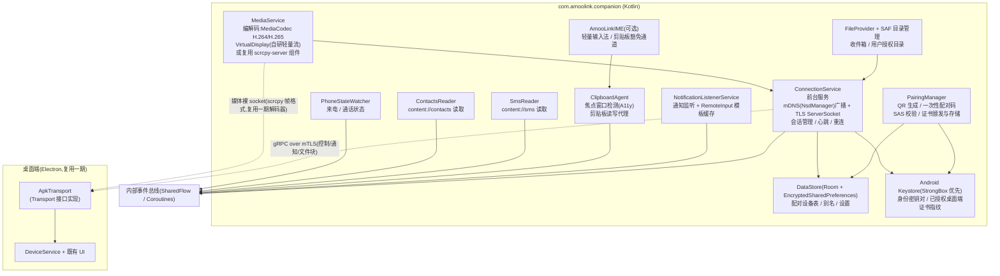
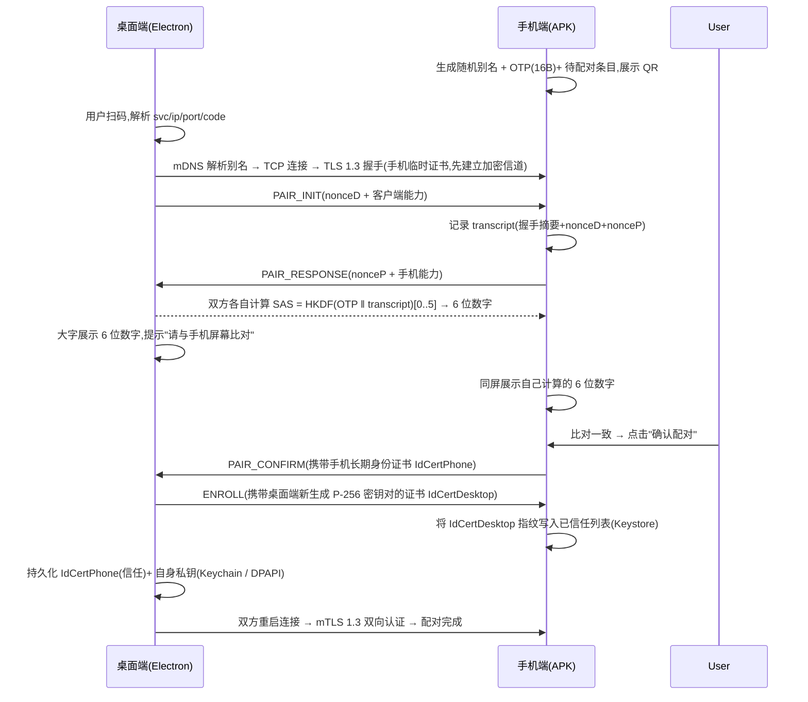

# 04 - 伴侣 APK 设计(二期)

> 状态:设计定稿(v1.0,2026-10-26)
> 关联:[01-产品需求与功能清单](./01-产品需求与功能清单.md) · [02-系统架构设计](./02-系统架构设计.md) · [03-核心技术方案](./03-核心技术方案(scrcpy协议与ADB通路).md) · [05-安全与隐私设计](./05-安全与隐私设计.md)
> 目标机型:StepX PZ261A(Android 16 / SDK 36 / arm64-v8a,已实测)

## 1. 概述与目标

一期 AmooLink 以"纯 ADB 免装 App"方式交付,零安装成本即可获得投屏、反控、文件互传等核心体验。但 adb 的 `shell`(uid 2000)权限天然存在边界:它既没有 SMS / Contacts 等危险权限,也无法注册 `NotificationListenerService`、无法申请输入法身份。二期伴侣 APK(`com.amoolink.companion`,Kotlin)的目标是:

1. **补齐能力**:通知快捷回复、短信 / 通讯录、来电提醒、稳定剪贴板等一期受限项;
2. **摆脱 USB 调试依赖**:通过 mDNS 发现 + mTLS 自建通道,普通用户无需打开开发者选项;
3. **保持体验一致**:桌面端 UI 与服务层完全复用,仅新增一条 `ApkTransport`,由能力协商决定各功能的可用性。

二期与一期**并存而非替代**:插着 USB 线且装有 APK 的手机,两条通道可同时存在、自动择优。

## 2. 动机与能力矩阵

### 2.1 能力对比总表

图例:✅ 完整可用 · 🟡 受限 / 降级可用 · ❌ 不可行

| 能力 | 一期 ADB 免装 | 二期伴侣 APK | 说明 |
|---|---|---|---|
| 投屏(屏幕镜像) | ✅ | ✅ | ADB:内嵌 scrcpy-server.jar(shell 可执行 app_process);APK:复用 scrcpy-server 代码或自研 MediaCodec 轻量流(见 §3.2) |
| 鼠标键盘反控 | ✅ | 🟡 | ADB:shell 身份注入事件,保真度最高(高频触摸/游戏);APK:普通应用无 `INJECT_EVENTS`,须经 AccessibilityService 手势派发,高频触摸略逊,文本输入由输入法联动补足 |
| 文件互传 | ✅ | ✅ | ADB:`push/pull`,可访问 shell 可见的全部共享存储;APK:FileProvider + SAF 授权目录,作用域内等效 |
| 剪贴板同步(读) | 🟡 | 🟡→✅ | ADB:依赖系统对 `com.android.shell` 的剪贴板豁免,部分 OEM ROM 限制;APK:Android 10+ 普通应用后台禁读,需焦点窗口检测 + 输入法联动(见 §2.2) |
| 剪贴板同步(写) | ✅ | ✅ | 后台写剪贴板不受 Android 10+ 限制 |
| 通知读取 | 🟡 | ✅ | ADB:`dumpsys notification --noredact` 轮询 diff,有秒级延迟、无 RemoteInput 句柄、常驻通知噪音大;APK:`NotificationListenerService` 实时回调,信息完整 |
| 通知快捷回复 | ❌ | ✅ | 回复必须持有 `RemoteInput` 结果句柄,仅 `NotificationListenerService` 可得,shell 无路径(见 §2.2) |
| 短信读取 | ❌ | ✅ | `content://sms` 需要 `READ_SMS` 运行时权限,uid 2000 无授权渠道 |
| 短信发送 | ❌ | ✅(可选) | shell 无法代发短信:`SEND_SMS` 为 dangerous + 安装时不可信权限;`service call isms` 在 Android 11+ 基本失效且不稳定,不作设计依赖 |
| 通讯录读取 | ❌ | ✅ | `content://contacts` 需要 `READ_CONTACTS`,同上 |
| 来电提醒 | 🟡 | ✅ | ADB:轮询 `dumpsys telephony.registry` 延迟大、无联系人姓名;APK:`READ_PHONE_STATE` + 电话状态监听,可与通讯录关联显示来电人 |
| 后台常驻(免线) | ❌ | ✅ | ADB 链路依赖 adb 会话,拔线即断,无线 adb 又要求 USB 调试常开;APK:前台服务 + 开机自启 |
| 免 USB 调试 | ❌ | ✅ | 一期整个信任与传输链路建立在 adb 之上;APK 走 mDNS + mTLS 自建通路,普通用户免开发者选项 |
| 多手机同时连接 | ✅ | ✅ | ADB:adbkit 天然多 transport;APK:每台手机独立前台服务实例,桌面端按设备别名区分 TCP 连接 |

**结论**:ADB 模式覆盖 P0 核心体验(投屏/反控/文件/剪贴板写);通知回复、短信、通讯录、来电、免调试常驻五项只能由 APK 补齐,这是二期立项的直接动因。

### 2.2 ADB 模式受限项的技术根因与 APK 对策

| 受限项 | 根因 | APK 对策 |
|---|---|---|
| 通知回复 | 回复动作 = 组装 `RemoteInput` 结果 PendingIntent 并 `send()`,该句柄只下发给 `NotificationListenerService` 注册方;shell 不可能获得 | `NotificationListenerService` 监听时缓存 `Sbn.getNotification().actions[]` 中的 RemoteInput 模板,收到桌面 `ReplyAction` 后填充文本回发 |
| 短信/通讯录 | Android 危险权限模型:权限只授予"安装且用户授权的包",`com.android.shell` 无 UI、无法申请 `READ_SMS` / `READ_CONTACTS`;运行时 `pm grant` 对此类权限对 shell 亦不可用(且属越权行为,不采用) | APK 以正规运行时权限流程申请;短信发送额外申请 `SEND_SMS`,默认关闭、引导页单独开启 |
| 剪贴板读取(Android 10+) | `ClipboardService` 自 Android 10 起仅允许**默认输入法**与**焦点应用**后台读;shell uid 有系统级豁免所以 ADB 模式勉强可用,但普通 APK 没有豁免 | 双保险:**(a) 焦点窗口检测**——通过 AccessibilityService 监听 `TYPE_WINDOW_STATE_CHANGED`,仅当桌面端投屏窗口为焦点时由桌面发起拉取(此时手机端 AmooLink 前台服务页面可中转);**(b) 输入法联动**——提供可选轻量输入法 `AmooLinkIME`,用户将其设为默认输入法后,依据"默认 IME 永远可读写剪贴板"的豁免实现稳定双向同步,设置页一键跳转输入法选择器 |
| 来电提醒 | 电话状态无系统广播开放给 shell;dumpsys 轮询延迟 ≥1s 且无法关联通讯录 | `READ_PHONE_STATE` + `TelephonyCallback`,来电时经 `CallState` 消息推送桌面,配合通讯录显示来电人姓名 |
| 免 USB 调试 | adb 信任模型 = 手机对电脑 RSA 密钥授权,开发者选项必须开启 | 见 §4 配对协议:mDNS + QR + 一次性配对码 + mTLS |

## 3. APK 总体架构

### 3.1 模块图



### 3.2 模块职责

| 模块 | 职责 | 备注 |
|---|---|---|
| ConnectionService | 唯一前台服务:mDNS 注册 `_amoolink._tcp.local.`(随机别名)、TCP Server + TLS 1.3、每桌面端一条 gRPC 双向流、心跳保活、后台断线重连策略 | Android 14+ 声明 `connectedDevice` 服务类型 |
| PairingManager | 配对态机(见 §4):生成 QR 与一次性配对码、SAS 比对、向新桌面端颁发信任 | 密钥材料只进 Keystore,不落盘明文 |
| NotificationListenerService | `onNotificationPosted/Removed` → 脱敏(遵循设置)→ `NotificationEvent` 推送;缓存回复模板承接 `ReplyAction` | 用户需在系统设置手动授权,提供引导页 |
| ClipboardAgent / AmooLinkIME | 焦点检测触发的剪贴板拉取/推送;IME 作为默认输入法时的豁免通道 | 两个策略可叠加,能力协商上报实际可用级别 |
| SmsReader / ContactsReader | ContentResolver 分页查询、增量同步(时间戳游标)、按需响应桌面请求 | 仅在桌面端请求时读取,不后台全量同步 |
| FileProvider + SAF | 默认收件箱 `Download/AmooLink/`;用户可通过 SAF 授权任意目录给桌面浏览 | 与一期 adb 文件浏览器共享桌面 UI 树 |
| MediaService | **方案 A(二期首发)**:内嵌 scrcpy-server(Apache-2.0)复用其编码与控制协议类,以本进程普通权限运行时改用 `MediaProjection` 或 A11y 注入;**方案 B(二期演进)**:自研轻量流——`MediaCodec` + `VirtualDisplay` 直出 H.264/H.265(可选 AV1),去掉 scrcpy 依赖并支持"单应用镜像" | 方案 A 复用一期客户端解码器,成本最低;方案 B 与方案 A 共用桌面端消息格式 |
| PhoneStateWatcher | 来电振铃/接起/挂断 → `CallState` 推送(号码仅上报哈希,姓名经通讯录解析后上报) | 见 05 号码脱敏 |
| DataStore / Keystore | 配对设备表、设备别名、功能开关;身份私钥与证书指纹 | StrongBox 可用则硬件保护 |

### 3.3 进程与线程模型

- 单进程(`:remote` 不拆分,降低 IPC 复杂度);协程 + `Dispatchers.IO` 承担 IO,媒体编码独立 `HandlerThread`。
- 前台服务常驻通知展示:已连接桌面别名、当前连接方式(Wi-Fi 直连 / 热点 / USB 网络共享)、快捷开关"断开全部"。

## 4. 配对协议

### 4.1 QR 码内容

QR 码由手机端"添加电脑"页面生成,内容为 AmooLink 私有 URI(约 120 字节,低纠错级别即可快速扫描):

```
amoolink://pair?v=1
  &svc=Sapphire-Falcon-42          ← mDNS 实例名(随机设备别名,见 05 §mDNS 隐私)
  &typ=_amoolink._tcp.local.        ← 服务类型(固定)
  &ip=192.168.1.23&port=47888       ← 当前网络直连地址(mDNS 解析失败时的兜底)
  &code=K5WQ7ZJ3FN2YT4E8            ← 一次性配对码 OTP(16 字节随机数 Base32,仅本次有效,5 分钟过期)
  &sig=...                          ← 对上述字段的 HMAC-SHA256(防 QR 内容被篡改)
```

安全性质(详见 [05-安全与隐私设计](./05-安全与隐私设计.md)):

- 别名不包含序列号 / 型号 / IMEI;
- `code` 只出现在 QR 中,绝不出现在任何网络报文;用于派生配对会话密钥与 6 位比对码(SAS);
- 配对码一次性、短时效,超时或失败即作废重新生成。

### 4.2 配对流程



要点:

- **MITM 防御**:TLS 握手用的是未认证证书,真正的认证锚点是 QR 中的 OTP——中间人没有 OTP,无法算出与两端一致的 6 位 SAS,用户比对即可发现;
- **SAS 与"手机端确认"双保险**:6 位数字比对挡中间人,"手机点击确认"挡桌面端被冒用(用户没扫码却收到确认弹窗时会警觉);
- 桌面端私钥永不出 Keychain / DPAPI;手机端身份私钥永不出 Android Keystore(优先 StrongBox)。

### 4.3 证书与密钥管理

| 对象 | 生成 | 存储 | 有效期 |
|---|---|---|---|
| 手机身份密钥对(P-256 ECDSA) | 首次配对时生成 | Android Keystore,`setAttestation` 不要求,禁止导出 | 长期,可轮换 |
| 桌面身份密钥对(P-256 ECDSA) | 每台电脑首次配对时生成 | macOS Keychain / Windows DPAPI(CryptProtectData)包裹 | 长期,可轮换 |
| 会话票据 | TLS 1.3 session ticket | 内存,ticket key 每 6 小时轮换、单次使用防重放 | 单次握手 |
| 一次性配对码 OTP | 每次"添加电脑" | 内存,5 分钟过期 | 一次性 |

### 4.4 重连、轮换与吊销

- **重连免确认**:配对完成后双方持久化对端证书,此后每次连接走标准 mTLS 1.3 双向认证 + 会话票据恢复,零用户交互;手机端常驻通知显示"最近连接: Sapphire-PC(2 小时前)"。
- **证书轮换**:在既有可信信道内发起(旧证书签名的 `ROTATE_REQUEST` → 新密钥对新证书 → 双方原子替换,旧证书保留 24h 宽限);建议每年或私钥疑似泄露时轮换。手机端"重置身份"= 轮换自身并作废所有已配对电脑。
- **吊销**:
  - 手机端"忘记此电脑" → 删除该桌面证书指纹,即刻断开其连接;
  - 桌面端"移除手机" → 删除手机证书与本机档案,并记录吊销指纹防止 TOFU 重绑;
  - 手机丢失/换机:新手机重新配对即新身份;桌面端可在"设备管理"作废旧档案。

## 5. 桌面端 ↔ APK 私有协议

### 5.1 选型论证:gRPC over mTLS vs 自定义 TLV

| 维度 | gRPC over mTLS(protobuf + HTTP/2) | 自定义 TLV over TLS |
|---|---|---|
| 开发成本 | `.proto` 单一事实源,Kotlin(`protobuf-kotlin` + `grpc-android`)与 TS(`ts-proto` + `@grpc/grpc-js`)双向 codegen | 需自研帧格式、版本号、错误码、心跳、背压 |
| 流式语义 | 原生 bidi streaming,天然适配通知上行 / 控制下行 | 手写状态机,易出边界 bug |
| 背压 | HTTP/2 流量控制,`FileChunk` 大文件传输免造轮子 | 需自实现滑动窗口 |
| 体积 | APK +约 2.5MB、桌面 +约 1.5MB | 接近零增量 |
| 与一期关系 | 控制面独立;媒体面**不走 gRPC** | — |

**决策**:控制 / 通知 / 文件块走 **gRPC over mTLS**(消息量小、语义复杂,codegen 与双向流收益远超体积代价);**媒体流(视频/音频)不走 gRPC**,沿用独立裸 TLS socket + scrcpy 帧格式,复用一期 `@amoolink/scrcpy-client` 解码器,零额外开销。TLV 方案保留为"极端体积敏感发行版"的后备,不默认实现。

### 5.2 消息定义示例(amoolink.proto 摘要)

```protobuf
syntax = "proto3";
package amoolink.v1;

// ---------- 控制面:单条 bidi 流,信封封装 ----------
service AmooLinkChannel {
  // 桌面端发起;双向流上跑所有控制/通知/文件块消息
  rpc Channel(stream DesktopFrame) returns (stream PhoneFrame);
}

message DesktopFrame {
  uint64 seq = 1;
  oneof body {
    CapabilityReport capability = 2;   // 能力协商(连接后首条)
    ClipboardSet     clipboard_set = 3;
    ClipboardGet     clipboard_get = 4;
    FileOpen         file_open     = 5;   // 打开/创建传输会话
    FileChunk        file_chunk    = 6;   // 桌面 → 手机(上传)
    FileRead         file_read     = 7;   // 手机 → 手机侧按 offset 回传 FileChunk
    ReplyAction      reply         = 8;   // 通知快捷回复
    SmsQuery         sms_query     = 9;
    ContactsQuery    contacts_query = 10;
    Ping             ping          = 15;
  }
}

message PhoneFrame {
  uint64 seq = 1;
  oneof body {
    CapabilityReport capability   = 2;
    ClipboardSync    clipboard    = 3;   // 主动推送:手机复制了内容
    NotificationEvent notification = 4;
    CallState        call         = 5;
    FileChunk        file_chunk   = 6;   // 手机 → 桌面(下载)
    FileMeta         file_done    = 7;
    SmsPage          sms_page     = 8;
    ContactsPage     contacts_page = 9;
    Error            error        = 14;
    Pong             pong         = 15;
  }
}

// ---------- 核心消息 ----------
message ClipboardSync {
  int64  revision   = 1;   // 单调递增,防乱序回放
  enum Kind { TEXT = 0; IMAGE = 1; }
  Kind   kind       = 2;
  string text       = 3;   // kind=TEXT
  bytes  image_ref  = 4;   // kind=IMAGE:sha256,大内容走文件通道分块
  string src_device = 5;   // 哪台设备复制
  int64  timestamp  = 6;   // epoch ms
}

message FileChunk {
  string transfer_id = 1;
  uint64 offset      = 2;
  bytes  data        = 3;   // ≤ 64 KiB
  bool   last        = 4;
  bytes  sha256      = 5;   // last=true 时整文件校验
}

message NotificationEvent {
  enum Action { POSTED = 0; REMOVED = 1; }
  Action action          = 1;
  string key             = 2;   // 系统通知 key(回复时回传)
  string package         = 3;
  string app_name        = 4;
  string title           = 5;   // 脱敏开关生效时仅保留本字段(见 05)
  string text            = 6;   // 脱敏开关生效时置空
  bool   ongoing         = 7;
  int64  post_time       = 8;
  repeated RemoteInputSlot replies = 9;   // 可用快捷回复槽位
}

message RemoteInputSlot {
  string action_id     = 1;   // 回复动作句柄
  string input_key     = 2;
  repeated string hints = 3;  // 预设回复词(从通知extras提取)
}

message ReplyAction {
  string notification_key = 1;
  string action_id        = 2;
  string input_key        = 3;
  string text             = 4;
}

message CallState {
  enum State { IDLE = 0; RINGING = 1; OFFHOOK = 2; }
  State  state        = 1;
  string number_hash  = 2;   // sha256(号码) 前 8 字节,默认不上报明文
  string contact_name = 3;   // 通讯录匹配成功才有
}

message CapabilityReport { fixed64 bitmap = 1; }   // 见 §5.3
```

### 5.3 能力协商(capability bitmap)

连接建立后双方各发一条 `CapabilityReport`,有效能力 = `mine & theirs & 用户策略`。bit 定义(v1,从低位起):

| bit | 能力 | 说明 |
|---|---|---|
| 0 | SCREEN_MIRROR | 投屏 |
| 1 | REVERSE_CONTROL_RAW | 原始事件注入(ADB 模式为 1,APK 模式为 0) |
| 2 | REVERSE_CONTROL_A11Y | 手势派发反控 |
| 3 | FILE_TREE | 目录浏览 |
| 4 | FILE_PUSH_PULL | 文件传输 |
| 5 | CLIPBOARD_WRITE | 写剪贴板 |
| 6 | CLIPBOARD_READ_FOCUS | 焦点检测式读(降级) |
| 7 | CLIPBOARD_READ_IME | 输入法豁免式读(完整) |
| 8 | NOTIF_READ | 通知读取 |
| 9 | NOTIF_REPLY | 通知快捷回复 |
| 10 | SMS_READ | 短信读取 |
| 11 | SMS_SEND | 短信发送(默认关闭) |
| 12 | CONTACTS_READ | 通讯录 |
| 13 | CALL_STATE | 来电提醒 |
| 14 | AUDIO_FORWARD | 音频转发 |
| 15 | VIRTUAL_CAMERA | 虚拟摄像头源 |
| 16–31 | 保留 | 版本兼容:未知 bit 一律视为不支持 |

## 6. 与一期 ADB 模式的融合

### 6.1 Transport 抽象

桌面端 `DeviceService` 维护设备档案,每个连接绑定一个 `Transport` 实现;上层服务(Mirror / Transfer / Clipboard / Notify)只面向能力查询,不感知通道:

```ts
// packages/adb/src/transport.ts(一期已定义,二期新增实现)
export interface Transport {
  readonly kind: 'adb' | 'apk';
  /** 协商后的有效能力(双方 bitmap 与本地策略交集) */
  readonly capabilities: CapabilityBitmap;
  supports(cap: Capability): boolean;
  /** 控制面命令 */
  request<TReq, TRes>(op: Op, payload: TReq): Promise<TRes>;
  /** 事件流(通知/来电/剪贴板推送) */
  events(): AsyncIterableIterator<DeviceEvent>;
  /** 媒体通道(scrcpy 帧格式,两种传输层同构) */
  openMediaStream(opts: MirrorOptions): Promise<MediaStream>;
  close(): Promise<void>;
}

export class AdbTransport implements Transport { /* @u4/adbkit:track/push/pull/shell/dumpsys */ }
export class ApkTransport implements Transport { /* gRPC over mTLS + 媒体裸 socket */ }
```

### 6.2 通道选择与降级

- 同一手机同时有两条通道时,`DeviceService` 以能力 bitmap 加权择优(例:反控选 ADB 原始注入,通知回复走 APK),对上层表现为单设备多能力;
- USB 拔出 → 若该手机已配对 APK 且在同一局域网,自动切换 `ApkTransport`,投屏会话无缝续接(媒体流重建,桌面窗口保活);
- 反向降级:APK 通道不可用时回退 ADB,受能力位约束自动隐藏不可用功能(UI 以置灰 + "需要伴侣 APK"提示呈现)。

## 7. 权限清单与用途说明

| 权限 | 类型 | 用途 | 申请时机 |
|---|---|---|---|
| `INTERNET` | normal | TCP/TLS、mDNS | 安装即得 |
| `ACCESS_NETWORK_STATE` | normal | 判断 Wi-Fi / 热点可达性 | 安装即得 |
| `CHANGE_WIFI_MULTICAST_STATE` | normal | mDNS 组播锁(`WifiManager.MulticastLock`) | 前台服务启动 |
| `FOREGROUND_SERVICE` | normal | 前台服务本体 | 安装即得 |
| `FOREGROUND_SERVICE_CONNECTED_DEVICE` | normal(34+) | 声明服务类型 `connectedDevice` | 安装即得 |
| `POST_NOTIFICATIONS` | runtime(33+) | 常驻通知、来电线程式通知 | 首次启动引导页 |
| `BIND_NOTIFICATION_LISTENER_SERVICE` | service | NotificationListenerService 绑定(非弹窗授权,需系统设置页开启) | 引导页深链 `ACTION_NOTIFICATION_LISTENER_SETTINGS` |
| `READ_SMS` | runtime(受限) | 短信读取;因属 Play 受限权限,APK 走官网直发分发,不依赖 Play | 短信功能首次使用时 |
| `SEND_SMS` | runtime(受限,默认关闭) | 短信代发 | 设置页显式开关 + 二次确认 |
| `READ_CONTACTS` | runtime | 通讯录读取、来电姓名解析 | 通讯录/来电功能首次使用时 |
| `READ_PHONE_STATE` | runtime | 通话状态监听 | 来电提醒首次使用时 |
| `RECEIVE_BOOT_COMPLETED` | runtime(用户可控) | 开机自启恢复前台服务(遵循"开机自启"设置) | 引导页,默认询问 |
| `REQUEST_IGNORE_BATTERY_OPTIMIZATIONS` | special | 申请电池优化白名单(保活必要非充分) | 引导页,见 §8 |
| `BIND_ACCESSIBILITY_SERVICE` | service(可选) | 焦点窗口检测 + 手势反控(可选组件,不装则对应能力位为 0) | 用户在系统页手动开启 |

**权限原则**:功能触发式申请,不用不弹;`SEND_SMS`、AccessibilityService 均为可选组件;每次申请前用应用内说明页交代用途(与 05 隐私清单一致)。

## 8. Android 版本适配要点

| 版本 | 要点 |
|---|---|
| Android 10(API 29) | 后台剪贴板读取限制 → §2.2 焦点检测 + IME 联动; Scoped storage 起步 → 文件访问统一走 FileProvider/SAF |
| Android 11(API 30) | 权限"未使用自动撤销"(`autoRevoke`):前台服务常驻应用也会被用户侧关闭,引导页检测并深链 `ACTION_APPLICATION_DETAILS_SETTINGS`;无线调试 `adb pair` 仅影响一期 |
| Android 12(API 31) | 通知 trampoline 禁令:常驻通知点击只能 `activity` PendingIntent,不可经 service/broadcast 中转——通知点击统一打开 APK 主页;前台服务启动限制(后台启动 FGS 受限)→ 开机自启使用 `BOOT_COMPLETED` 豁免链 |
| Android 13(API 33) | `POST_NOTIFICATIONS` 运行时权限,拒绝后常驻通知降级为静默 FGS(功能不受影响但用户不可见,需引导);通知渠道细分:连接状态 / 来电 / 文件接收 |
| Android 14(API 34) | FGS 必须声明具体类型:ConnectionService=`connectedDevice`,媒体编码会话=`mediaProjection`(投屏需用户每会话授权);**photo picker 适配**:相册导出改用 `PickVisualMedia`,替代 `READ_MEDIA_IMAGES/VIDEO`,零权限即可选图 |
| Android 15(API 35) | `dataSync` 类型 FGS 限时 6 小时——文件传输不注册 `dataSync` 长驻,而是短时服务 + 前台通知;`connectedDevice` 不受限(需声明 `FOREGROUND_SERVICE_CONNECTED_DEVICE`) |
| Android 16(API 36,目标机型实测版) | 以 PZ261A 真机回归为准:验证 FGS 政策、通知监听、剪贴板豁免路径、MediaCodec AV1 编码可用性 |
| 全版本 | 电池优化白名单引导:先 `ACTION_REQUEST_IGNORE_BATTERY_OPTIMIZATIONS` 直弹系统对话框;被拒后提供厂商电池管理页面导航提示(通用文案,不内置厂商私有深链);"自启动"开关由用户自查,设置页给出机型化引导文案 |

## 9. 里程碑(摘要)

| 阶段 | 内容 | 验收 |
|---|---|---|
| M5.1 | APK 骨架 + mDNS 广播 + mTLS + QR 配对 | PZ261A ↔ macOS 完成 QR 配对,重连免确认 |
| M5.2 | gRPC 通道 + 能力协商 + Transport 融合 | 桌面端同屏管理 ADB/APK 双通道设备 |
| M5.3 | 通知监听 + 快捷回复 + 来电 | 电脑上回复微信/QQ 消息;来电弹提醒 |
| M5.4 | 短信 / 通讯录 / 剪贴板 IME 联动 | 短信/通讯录面板可用;剪贴板稳定同步 |
| M5.5 | 自研轻量媒体流(方案 B,可选) | 单应用镜像 + AV1 试点 |

> 详细排期见 [06-路线图与里程碑](./06-路线图与里程碑.md)。
